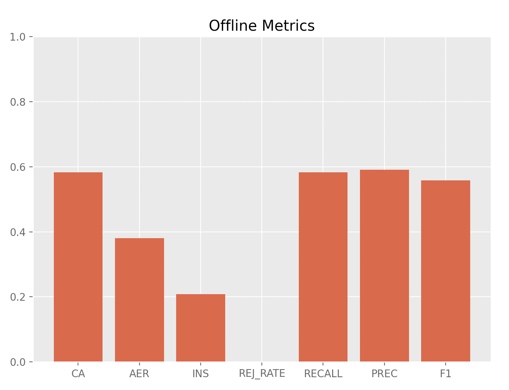
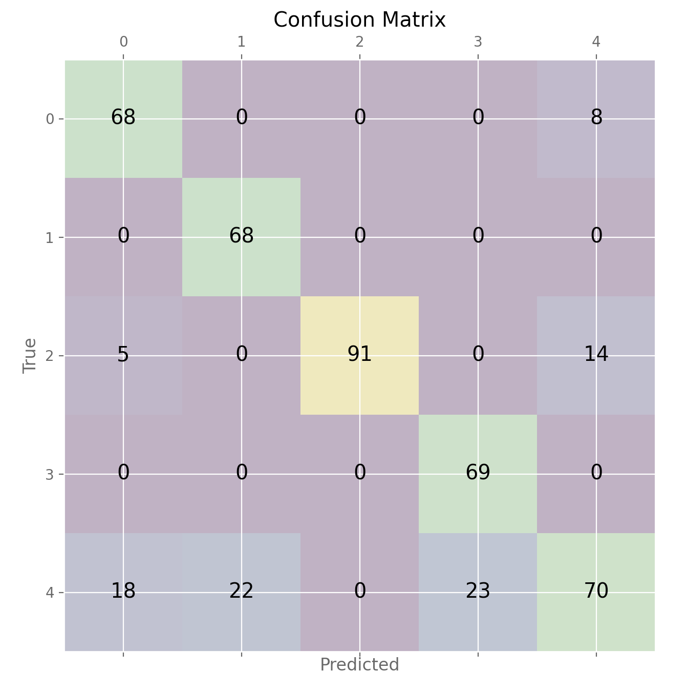

Evaluation techniques for myoelectric control can be divided into two categories: **online** and **offline** evaluation. This section presents each type of evaluation, explores their use cases, and provides suggestions on the best evaluation standards for a given project. 

## Offline Evaluation 
Offline evaluation involves testing a model using pre-recorded data by leveraging offline metrics. While these metrics do not necessarily correlate to online usability, they provide insight into the potential performance of a control system. Additionally, they are valuable for evaluating different control system parameters and exploring different algorithms before system deployment. An example of extracting offline metrics from predictions and labels can be found in the following code snippet. Stars beside the metrics indicate their popularity for evaluating EMG-based control systems. 

<details>
<summary><b>Example Code and Output</b></summary>

```Python
import numpy as np
from libemg.offline_metrics import OfflineMetrics

if __name__ == "__main__" :
    y_true = np.array([0,0,0,0,0,0,1,1,1,1,1,1,2,2,2,2,2,2,3,3,3,3,3,3])
    y_preds = np.array([1,0,0,0,0,2,1,1,1,1,1,1,1,2,3,3,3,3,1,1,2,3,3,3])

    om = OfflineMetrics()

    # Get and extract all of the classification metrics
    # (om.get_available_metrics() also lists the regression metrics described below):
    metrics = ['CA', 'AER', 'INS', 'REJ_RATE', 'CONF_MAT', 'RECALL', 'PREC', 'F1']
    offline_metrics = om.extract_offline_metrics(metrics=metrics, y_true=y_true, y_predictions=y_preds, null_label=2)
    print(offline_metrics)
    om.visualize(offline_metrics)

    # Get and extract a subset of metrics:
    metrics = ['AER', 'CA', 'INS']
    offline_metrics = om.extract_offline_metrics(metrics=metrics, y_true=y_true, y_predictions=y_preds, null_label=2)
    print(offline_metrics)
```



</details>
<br/>

`om.extract_common_metrics(y_true, y_preds, null_label=2)` is a shortcut for the three most common metrics (CA, AER and INS). AER is only computed when `null_label` is given. For classification data, predictions of `-1` (rejected decisions) are removed before every metric except REJ_RATE is computed.


### **Classification Accuracy (CA)** *
The percentage of correctly predicted samples. While this is a common evaluation metric, it does not necessarily correlate to online usability.

$
\text{CA} = \frac{1}{N}\sum_{i=1}^{N}\hat{y}_{i} == {y}_{i}
$

where $N$ is the total number of data frames/predictions, $\hat{y}_{i}$ is the predicted class label for frame $i$, and $y_{i}$ is the true class label for frame i.

### **Active Error (AER)** *
The percentage of incorrect predictions,  ignoring No Movement predictions. This metric evaluates the performance of a classifier on active class decisions. This is valuable as the No Movement class typically correlates to "do nothing" functionality. 

$
\text{AER} = \frac{1}{N_{A}}\sum_{i : \hat{y}_{i} \ne y_{NM}}\hat{y}_{i} \ne {y}_{i}
$

where $N_{A}$ is the number of data frames/predictions whose predicted label is not the no movement class, $\hat{y}_{i}$ is the predicted class label for frame $i$, $y_{i}$ is the true class label for frame i, and $y_{NM}$ is the no movement/null class (the `null_label` argument).

### **Instability (INS)** *
The number of times that subsequent predictions differ, beyond the number of times the true label changes, normalized by the total number of predictions. This metric provides insight into the stability of a classifier (i.e., lack of fluctuating predictions). Changes that the ground truth itself makes are not counted against the classifier, and the result is never below 0.

$
\text{INS} = \max\left(0, \frac{1}{N}\left(\sum_{i=2}^{N}[\hat{y}_{i} \ne \hat{y}_{i-1}] - \sum_{i=2}^{N}[y_{i} \ne y_{i-1}]\right)\right)
$

where $N$ is the total number of data frames/predictions, $\hat{y}_{i}$ is the predicted class label for frame $i$, and $y_{i}$ is the true class label for frame $i$.

### **Rejection Rate (REJ_RATE)**
For control systems leveraging rejection, this metric corresponds to the percentage of rejected decisions. This gives insight into whether the system is over or under-rejecting. 

$
\text{REJ_RATE} = \frac{1}{N}\sum_{i=1}^{N}\hat{y}_{i} == y_{rej}
$

where $N$ is the total number of data frames/predictions, $\hat{y}_{i}$ is the predicted class label for frame $i$, and $y_{rej}$ is the rejection label (default = -1).

### **Confusion Matrix (CONF_MAT)** *
A confusion Matrix is a $C$ x $C$ matrix, where $C$ is the number of classes. Each row of the matrix represents the true label, and each column represents the predicted label. This matrix provides valuable insight into what classes get confused with others.

<style>
    img {
        width: 50%;
        display: block;
        margin-left: auto;
        margin-right: auto;
    }
</style>


### **Recall (RECALL)**
The measure that relates the times you predicted the active class correctly over the total number of active class occurences.

$
\text{RECALL} = \frac{TP}{(FN + TP)}
$

where $TP$ is the number of true positives, and $FN$ is the number of false negatives. Recall is computed for each class and averaged, weighted by the number of samples of each class. PREC and F1 are averaged in the same way.

### **Precision (PREC)**
The meaure that relates the times you predicted the active class correctly over all the times you predicted the active class.

$
\text{PREC} = \frac{TP}{(FP + TP)}
$

where $TP$ is the number of true positives, and $FP$ is the number of false positives.

### **F1 Score (F1)**
A measure of accuracy that has been normalized by the number of samples within the class. Good for datasets with unbalanced class representation.

$
\text{F1} = 2 \times \frac{(Precision \times Recall)}{Precision + Recall}
$

### Regression Metrics
For regressors, `y_true` and `y_predictions` are (N x M) arrays, where M is the number of degrees of freedom (DOFs), and each metric returns one value per DOF.

| Metric | Description |
| --- | --- |
| `R2` | Coefficient of determination: $1 - \sum (\hat{y}_{i} - y_{i})^2 / \sum (y_{i} - \bar{y})^2$ |
| `MSE` | Mean squared error: $\frac{1}{N}\sum (y_{i} - \hat{y}_{i})^2$ |
| `RMSE` | Root mean squared error: $\sqrt{\text{MSE}}$ |
| `NRMSE` | RMSE normalized by the range of the true values: $\text{RMSE} / (\max(y) - \min(y))$ |
| `MAE` | Mean absolute error: $\frac{1}{N}\sum \lvert y_{i} - \hat{y}_{i} \rvert$ |
| `MAPE` | Mean absolute percentage error: $\frac{1}{N}\sum \lvert (y_{i} - \hat{y}_{i}) / y_{i} \rvert$ (as a fraction; true values of 0 are replaced by machine epsilon, so targets at 0 give very large values) |

```Python
metrics = ['R2', 'MSE', 'RMSE', 'NRMSE', 'MAE']
offline_metrics = om.extract_offline_metrics(metrics=metrics, y_true=test_labels, y_predictions=predictions)
```

## Online Evaluation 
Online evaluation involves user-in-the-loop interaction, meaning that users get real-time feedback as they interact with the control system. One online evaluation technique popular within the prosthetics community involves leveraging Fitts law tests <sup>[1]</sup>. This is common in the prosthetics community as prostheses are expensive, and fittings are complicated. For more generic use cases, online evaluation should involve user-in-the-loop feedback. Ultimately, to properly evaluate the online performance of a control system, the OnlineEMGClassifier module should be leveraged.

# References
<a id="1">[1]</a> 
Scheme EJ, Englehart KB. Validation of a selective ensemble-based classification scheme for myoelectric control using a three-dimensional Fitts' Law test. IEEE Trans Neural Syst Rehabil Eng. 2013 Jul;21(4):616-23. doi: 10.1109/TNSRE.2012.2226189. Epub 2012 Oct 25. PMID: 23193252.