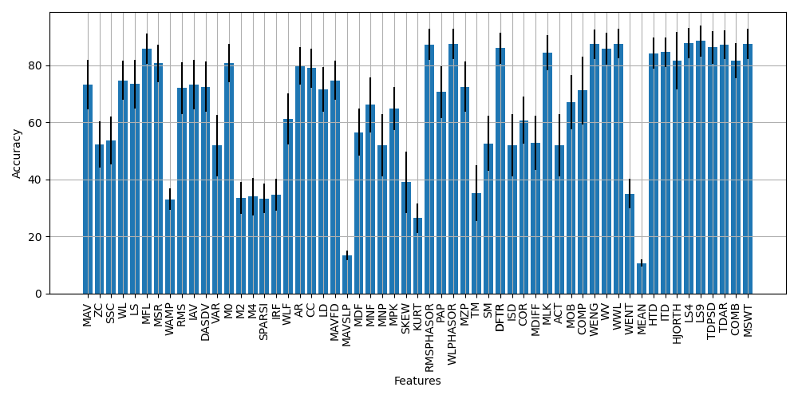

Due to the stochastic and transient nature of the EMG signal, the raw signal provides little information. As such, hand-crafted features are extracted from the underlying signal to increase its information density before being passed to the machine learning model. These features are extracted from windows (i.e., a predefined number of samples) of EMG. The selection of features (or feature sets) is essential for robust control systems.

This module aims to simplify the feature extraction stage for developers. We have included a number of features from the literature that we have robustly tested and validated. The following code snippet exemplifies how to extract features from raw EMG:

<details>
<summary><b>Example Code</b></summary>

```Python
import numpy as np
from libemg.feature_extractor import FeatureExtractor
from libemg.utils import get_windows

fe = FeatureExtractor()

# Load data from a csv file:
data = np.loadtxt("emg_data.csv", delimiter=",")
# Split the raw EMG into windows 
windows = get_windows(data, 50, 25)

# Extract a list of features
feature_list = ['MAV', 'SSC', 'ZC', 'WL']
features_1 = fe.extract_features(feature_list, windows)

# Extract a predefined feature group
features_2 = fe.extract_feature_group('HTD', windows)
```
</details>
<br/>

`windows` has the shape (N windows x N channels x N samples). Both calls return a dictionary mapping each feature's abbreviation to an array with one row per window (most features give one column per channel; some, such as AR, CC, DFTR, the phasor features and the wavelet features, give several columns per channel). Pass `array=True` to get a single (N windows x N features) array instead. `fe.get_feature_list()` and `fe.get_feature_groups()` return the available features and feature groups. Requesting a name that is not in the feature list raises a `ValueError`.

**Note that some features have parameters that must be tuned for a particular problem and hardware implementation.** These are passed through the `feature_dic` argument, keyed by the feature's abbreviation followed by the parameter name:

```Python
feature_dic = {
    'WAMP_threshold': 0.01,  # amplitude difference that counts towards WAMP
    'MDF_fs': 2000,          # sampling frequency used by the median frequency
    'AR_order': 9,           # order of the autoregressive model
}
features = fe.extract_features(['WAMP', 'MDF', 'AR'], windows, feature_dic=feature_dic)
```

`extract_features` can also standardize the features: with `normalize=True` it returns `(features, scaler)`, and the returned scaler should be passed as `normalizer` when extracting the test features. `fix_feature_errors=True` replaces NaN and infinite values with 0.

# Feature Performance
Each of the ~50 features that were implemented were tested individually with a linear discriminant analysis (LDA) classifier on the 3DCdataset. Note: some of these features are designed to improve robustness to factors (i.e., power line interference, limb position effect, contraction intensity variability), and as such, don't achieve high accuracy on their own for this gesture recognition task. Their value shouldn't be discounted when used in a rounded feature set for real-world use. The code associated with Figure 1 can be found in the example code tab below.



<center> <p> Figure 1: Individual Accuracy of Each Feature on the 3DCDataset</p> </center>

<details>
<summary><b>Example Code</b></summary>

```Python
import os
import sys
import numpy as np
import pickle
import matplotlib.pyplot as plt
from libemg.datasets import _3DCDataset
from libemg.emg_predictor import EMGClassifier
from libemg.feature_extractor import FeatureExtractor
from libemg.utils import make_regex
from libemg.data_handler import OfflineDataHandler
from libemg.offline_metrics import OfflineMetrics
from libemg.filtering import Filter

if __name__ == "__main__":
    # get the 3DC Dataset using library handle - this downloads the dataset
    dataset = _3DCDataset(dataset_folder='example_data/_3DCDataset/')
    # take the downloaded dataset and load it as an offlinedatahandler (split=False returns a single handler)
    odh = dataset.prepare_data(split=False)

    # Perform an analysis where we test all the features available of the library individually for within-subject
    # classification accuracy.

    # setup out model type and output metrics
    model = "LDA"
    om = OfflineMetrics()
    metrics = ['CA']

    # get the subject list
    subject_list = list(range(0,22))
    
    # initialize our feature extractor
    fe = FeatureExtractor()
    feature_list = fe.get_feature_list()

    # get the variable ready for where we save the results
    results = np.zeros((len(feature_list), len(subject_list)))

    for s in subject_list:
        subject_data = odh.isolate_data("subjects",[s])
        subject_train = subject_data.isolate_data("sets",[0])
        subject_test  = subject_data.isolate_data("sets",[1])

        # apply a standardization on the raw data (x - mean)/std
        filter = Filter(sampling_frequency=1000)
        filter_dic = {
            "name": "standardize",
            "data": subject_train
        }
        filter.install_filters(filter_dic)
        filter.filter(subject_train)
        filter.filter(subject_test)

        # from the standardized data, perform windowing
        train_windows, train_metadata = subject_train.parse_windows(200,100)
        test_windows, test_metadata = subject_test.parse_windows(200,100)

        # for each feature in the feature list
        for i, f in enumerate(feature_list):
            train_features = fe.extract_features([f], train_windows)
            test_features  = fe.extract_features([f], test_windows)

            # get the dataset ready for the classifier
            data_set = {}
            data_set['training_features'] = train_features
            data_set['training_labels'] = train_metadata["classes"]

            # setup the classifier
            classifier = EMGClassifier(model)
            classifier.fit(feature_dictionary=data_set.copy())

            # run the classifier on the test features
            preds,probs = classifier.run(test_features)
            # get the CA: classification accuracy offline metric and add it to the results
            results[i,s] = om.extract_offline_metrics(metrics, test_metadata['classes'], preds)[metrics[0]] * 100
            print(f"S{s} {f}: {results[i,s]}%")
    # the feature accuracy is represented by the mean accuracy across the subjects
    mean_feature_accuracy = results.mean(axis=1)
    std_feature_accuracy  = results.std(axis=1)


    plt.bar(feature_list, mean_feature_accuracy, yerr=std_feature_accuracy)
    plt.grid()
    plt.xlabel("Features")
    plt.ylabel("Accuracy")
    plt.show()
```

</details>
<br/>

# Features
Let $x_{i}$ represents the signal in segment i and $N$ denotes the number of samples in the timeseries.

Let $fj$ be the frequency of the spectrum at frequency bin $j$, $P_{j}$ is the
EMG power spectrum at frequency bin $j$, and $M$ is the length of the frequency bin.

**Note: every feature and feature group is associated with an abbreviation (e.g., MAV). This is how we refer to a specific feature in our library and is how you should interface with it.**

## **Mean Absolute Value (MAV)** <sup>[1]</sup>

The average of the absolute value of the EMG signal. This is one of the most commonly used features for EMG.

$
\text{MAV} = \frac{1}{N}\sum_{i=1}^{N} |x_{i}|
$

## **Mean (MEAN)**

The average of the signal (without taking its absolute value). For a zero-mean EMG signal this is close to 0; it is mainly useful for signals with a meaningful offset.

$
\text{MEAN} = \frac{1}{N}\sum_{i=1}^{N} x_{i}
$

## **Zero Crossings (ZC)** <sup>[1]</sup>
The number of times that the amplitude of the EMG signal crosses zero (i.e., consecutive samples go from strictly positive to strictly negative, or the reverse). No amplitude threshold is applied.

$
\text{ZC} = \sum_{i=1}^{N-1}f(x_{i} \times x_{i+1})
$

$
f(x) = \left\{\begin{array}{lr}
    1, & \text{if } x < 0 \\
    0, & \text{otherwise }
    \end{array}\right\}
$

## **Slope Sign Change (SSC)** <sup>[1]</sup>
The number of times that the slope of the EMG signal changes (i.e., the number of times that it changes between positive and negative). The threshold is set with `SSC_threshold` (a float, default 0.0).

$
\text{SSC} = \sum_{i=2}^{N-1}[f[(x_{i} - x_{i-1}) \times (x_{i} - x_{i+1})]] \\
$

$
f(x) = \left\{\begin{array}{lr}
    1, & \text{if } x \ge \text{threshold} \\
    0, & \text{otherwise }
    \end{array}\right\}
$

## **Waveform Length (WL)** <sup>[1]</sup>
The cumulative length of the EMG waveform over the passed in window. This feature is used to measure the overall complexity of the signal (i.e., higher WL means more complex).

$
\text{WL} = \sum_{i=1}^{N-1}|x_{i+1} - x_{i}|
$

## **L-score (LS)** <sup>[2]</sup>
The second L-moment (L-scale) of the samples in the window, computed by applying the shifted Legendre polynomial ($\text{LSP}$) to the probability-weighted moments ($B$) of the sorted samples.

$
\text{LS} = \sum_{i=1}^{N} \text{LSP} * B
$

## **Maximum Fractal Length (MFL)** <sup>[3]</sup>
A nonlinear information feature for the EMG waveform that is relatively invariant to contraction intensity.

$
\text{MFL} = log_{10} \sum_{i=1}^{N-1}  | x_{i+1} - x_{i} |
$

## **Mean Squared Ratio	(MSR)** <sup>[4]</sup>
Determines the total amount of activity in a window.

$
\text{MSR} = \left|\frac{1}{N}\sum_{i=1}^{N}(x_{i})^{\frac{1}{2}}\right|
$

The square root is taken over the complex numbers (negative samples contribute imaginary parts), and the magnitude of the complex mean is returned.

## **Willison Amplitude (WAMP)** <sup>[1]</sup>
The number of times that the difference between the amplitudes of two consecutive samples exceeds a pre-defined threshold. This feature is related to the firing of motor unit action potentials and muscle contraction force. The threshold is set with `WAMP_threshold` (a float, default 2e-3) and should suit the scale of the signal.

$
\text{WAMP} = \sum_{i=1}^{N-1}f(|x_{i}-x_{i+1}|) \\
$

$    
f(x) = \left\{\begin{array}{lr}
    1, & \text{if } x > \text{threshold} \\
    0, & \text{otherwise }
    \end{array}\right\}
$

## **Root Mean Square (RMS)** <sup>[1]</sup>
Models the signal as an amplitude modulated Gaussian random process that relates to constant force and non-fatiguing contraction.

$
\text{RMS} = \sqrt{\frac{1}{N}\sum_{i=1}^{N}x_{i}^{2}}
$

## **Integral of Absolute Value (IAV)** <sup>[1]</sup>
The integral of the absolute value. Also known as IEMG.

$
\text{IAV} = \sum_{i=1}^{N} |x_{i}|
$

## **Difference Absolute Standard Deviation Value (DASDV)** <sup>[1]</sup>
Standard deviation of the wavelength.

$
\text{DASDV}=\sqrt{\frac{1}{N-1}\sum_{i=1}^{N-1} (x_{i+1} - x_{i})^2} 
$

## **Variance (VAR)** <sup>[5]</sup>
Calculates the variance of the data.

$
\text{VAR} = \frac{1}{N}\sum_{i=1}^{N} (x_{i} - \mu _x)^{2}
$

## **Time Domain Power Spectral Descriptors (M0, M2, M4, SPARSI, IRF, WLF)** <sup>[6]</sup>
The six TDPSD features share the same construction. For a signal $x$ with first and second differences $\Delta x$ and $\Delta^{2} x$, three normalized moments are computed:

$
\bar{m}_{0}(x) = \frac{1}{0.1}\left(\frac{\sqrt{\sum_{i=1}^{N}x_{i}^2}}{N-1}\right)^{0.1}, \quad
\bar{m}_{2}(x) = \frac{1}{0.1}\left(\sqrt{\frac{\sum_{i=1}^{N-1}(\Delta x_{i})^2}{N-1}}\right)^{0.1}, \quad
\bar{m}_{4}(x) = \frac{1}{0.1}\left(\sqrt{\frac{\sum_{i=1}^{N-2}(\Delta^{2} x_{i})^2}{N-1}}\right)^{0.1}
$

Each feature evaluates its own statistic $g$ (given below) twice: on the window $x$ and on its log energy $y = \log(x^{2} + \epsilon)$. The two are then combined into the returned value:

$
\text{feature} = \frac{-2\,g(x)\,g(y)}{g(x)^{2} + g(y)^{2}}
$

## **First Temporal Moment (M0)** <sup>[6]</sup>
A commonly-used feature part of the TDPSD feature set.

$
g_{\text{M0}}(x) = log(|\bar{m}_{0}(x)|)
$

## **Second Temporal Moment (M2)** <sup>[6]</sup>
A commonly-used feature part of the TDPSD feature set.

$
g_{\text{M2}}(x) = log(|\bar{m}_{0}(x) - \bar{m}_{2}(x)|)
$

## **Fourth Temporal Moment (M4)** <sup>[6]</sup>
A commonly-used feature part of the TDPSD feature set.

$
g_{\text{M4}}(x) = log(|\bar{m}_{0}(x) - \bar{m}_{4}(x)|)
$


## **Sparsness (SPARSI)** <sup>[6]</sup>
A commonly-used feature part of the TDPSD feature set.

$
g_{\text{SPARSI}}(x) = log( |\frac{\sqrt{ | (\bar{m}_{0}-\bar{m}_{2})(\bar{m}_{0}-\bar{m}_{4}) | }}{\bar{m}_{0}} |)
$

## **Irregularity Factor (IRF)** <sup>[6]</sup>
A commonly-used feature part of the TDPSD feature set.

$
g_{\text{IRF}}(x) = log ( | \frac{\bar{m}_{2}}{\sqrt{\bar{m}_{0}\bar{m}_{4}}} | )
$

## **Waveform Length Factor (WLF)** <sup>[6]</sup>
A commonly-used feature part of the TDPSD feature set.

$
g_{\text{WLF}}(x) = log \left(\sqrt{\sum_{i=1}^{N-1} | \Delta x_{i} | / \sum_{i=1}^{N-2} | \Delta^{2} x_{i} |}\right)
$

## **Autoregressive Coefficients (AR)** <sup>[1]</sup>
The coefficients $a_{1}, \ldots, a_{r}$ of an order-$r$ linear predictor fit to each channel of the window with Burg's method (`librosa.lpc`), such that:

$
x_{i} \approx -\sum_{k=1}^{r} a_{k}\,x_{i-k}
$

The order is set with `AR_order` (an int, default 4), and the feature returns $r$ values per channel. AR4 and AR9 in the literature are `AR` with `AR_order` set to 4 and 9.

## **Cepstral Coefficient (CC)**
Computed recursively from the AR coefficients $a_{r}$ of the same order, set with `CC_order` (an int, default 4):

$
\text{CC}_{1}= -a_{1} \\
$

$
\text{CC}_{r}= -a_{r} - \sum_{l=1}^{r-2} \left(1 - \frac{l}{r-1}\right) a_{r}\,\text{CC}_{r-l}, \quad r = 2, \ldots, \text{CC\_order}
$

The recursion for $r \ge 2$ is only applied when `CC_order` is greater than 2.


## **Log Detector (LD)** <sup>[1]</sup>
Provides an estimate of the muscle contraction force.

$
\text{LD} = e^{\frac{1}{N}\sum_{i=1}^{N} log(|x_{i}| + 1)}
$

## **Mean Absolute Value First Difference (MAVFD)**
Gets the mean absolute value of the slope of the signal.

$
\text{MAVFD} = \frac{1}{N-1}\sum_{i=1}^{N-1} |x_{i+1}-x_{i}|
$

## **Mean Absolute Value Slope (MAVSLP)** <sup>[1]</sup>
Get the slope between p sections within a window. The number of sections is set with `MAVSLP_segment` (an int, default 2), and $p-1$ values are returned per channel, each the MAV of a section minus the MAV of the section before it. Here demonstrated for p=2.

$
\text{MAVSLP}_{p} = \sum_{i=\frac{N}{p} + 1}^{N} \frac{|x_{i}|}{(\frac{N}{P})} - \sum_{j=1}^{\frac{N}{p}}\frac{|x_{j}|}{(\frac{N}{P})}
$

## **Median Frequency (MDF)** <sup>[1]</sup>
Frequency at which the EMG power spectrum is divided into 2 portions with equal power. It is the frequency of the first bin $m$ at which the cumulative power passes half of the total power:

$
\text{MDF} = f_{m}, \quad m = \min\{k : \sum_{j=1}^{k}{P_{j}} > \frac{1}{2}\sum_{j=1}^{M}{P_{j}}\}
$

The power spectrum used by MDF, MNF, MNP, SM and DFTR is the FFT of the window, zero-padded to the next power of two. The sampling frequency is set with `MDF_fs` (default 1000); MNF, SM and DFTR take `MNF_fs`, `SM_fs` and `DFTR_fs` in the same way.

## **Mean Frequency (MNF)** <sup>[1]</sup>
Computes the average frequency of the EMG spectrum.

$
\text{MNF} = (\sum_{j=1}^{M}{f_{j}P_{j}})/(\sum_{j=1}^{M}{P_{j}})
$

## **Mean Power (MNP)** <sup>[1]</sup>
Computes the average power of the EMG spectrum.

$
\text{MNP} = \frac{1}{M}\sum_{j=1}^{M}P_{j}
$

## **Maximum/Peaks (MPK) <sup>[1]</sup>**
A feature that records the highest amplitude within the window:

$
\text{MPK} = max(x)
$

## **Skewness (SKEW)** <sup>[7]</sup>
Characterizes the degree of asymmetry in the distribution of a variable.

$
\text{SKEW} = (\frac{1}{N}\sum_{i=1}^{N}(x_i-\mu)^3) / (\frac{1}{N}\sum_{i=1}^{N}(x_i-\mu)^2)^{\frac{3}{2}}
$

## **Kurtosis (KURT)** <sup>[7]</sup>
Indicates non-gaussianity and used to identify the peakedness of a distribution. The Pearson definition is used, so a Gaussian signal gives a value of 3 (no 3 is subtracted).

$
\text{KURT} = (\frac{1}{N}\sum_{i=1}^{N}{(x_{i}-\mu)^4})/(\frac{1}{N}\sum_{i=1}^{N}{(x_{i}-\mu)^2})^2
$

## **Root Mean Squared Phasor (RMSPHASOR)** <sup>[12]</sup>
A feature that computes all channel-wise differences in RMS values and incorporates spatial resolution to get the predominant directions of RMS and the derivative of RMS. $RMSi_{c}$ refers to the complex-valued spatial RMS of channel i. $dRMSi_{c}$ refers to the same complex-valued spatial RMS computed on the derivative of the channel i signal. This feature set returns (N)(N-1)/2 RMSPHASOR features and (N)(N-1)/2 dRMSPHASOR features for a total of (N)(N-1) features for N channels.

$
\text{RMSPHASOR}_{i,j} = \text{log}(\text{norm}(RMSi_{c} - RMSj_{c}))
$

$
\text{dRMSPHASOR}_{i,j} = \text{log}\left(\frac{\text{norm}(RMSi_{c} - RMSj_{c})}{\text{norm}(dRMSi_{c} - dRMSj_{c})}\right)
$

## **Waveform Length Phasor (WLPHASOR)** <sup>[12]</sup>
A feature that computes all channel-wise differences in WL values and incorporates spatial resolution to get the predominant directions of WL and the derivative of WL. $WLi_{c}$ refers to the complex-valued spatial WL of channel i. $dWL_{c}$ refers to the same complex-valued spatial WL computed on the derivative of the channel i signal.
This feature set returns (N)(N-1)/2 WLPHASOR features and (N)(N-1)/2 dWLPHASOR features for a total of (N)(N-1) features for N channels.

$
\text{WLPHASOR}_{i,j} = \text{log}(\text{norm}(WLi_{c} - WLj_{c}))
$

$
\text{dWLPHASOR}_{i,j} = \text{log}\left(\frac{\text{norm}(WLi_{c} - WLj_{c})}{\text{norm}(dWLi_{c} - dWLj_{c})}\right)
$

## **Peak Average Power (PAP)** <sup>[13]</sup>
A peak average power computation using the time domain spectral moment computation method commonly used across the TDPSD feature set. The 0th, 2nd, and 4th order moments (here without the TDPSD normalization: $m_{0} = \sqrt{\sum x_{i}^{2}}$, $m_{2} = \sqrt{\sum (\Delta x_{i})^{2}}$, $m_{4} = \sqrt{\sum (\Delta^{2} x_{i})^{2}}$) are used to compute PAP using the following equation:

$
\text{PAP} = \frac{m_{0}}{m_{4}/m_{2}}
$

## **Multiplication of Peaks (MZP)** <sup>[13]</sup>
A spectral peak product using the time domain spectral moment computation method commonly used across the TDPSD feature set. It is computed from the first difference of the signal (the square root of the normalized 2nd order moment) using the following equation:

$
\text{MZP} = \sqrt{\frac{1}{N}\sum_{i=1}^{N-1}(x_{i+1} - x_{i})^{2}}
$


## **Temporal Moment (TM)** <sup>[1]</sup>
A temporal moment feature computed directly from the time domain. An order parameter is passed in that scales the signal prior to computing the moments. The zeroth order moment is constant, the first order moment is the MAV, and the second order moment is like the variance; therefore the feature should be used with order $\ge$ 3 (`TM_order`, default 3).

$
\text{TM} = \frac{1}{N}\sum_{i=1}^{N} |x_{i}^{order}|
$

## **Spectral Moment (SM)** <sup>[1]</sup>
A spectral moment feature computed from the frequency domain. An order parameter (`SM_order`, default 2) sets the power the frequencies are raised to, and the sampling frequency is set with `SM_fs` (default 1000). POW is the power spectrum of the signal and f is the frequencies associated with every sample of the power spectrum.

$
\text{SM} =  \sum_{i=1}^{F} pow_{i}*f_{i}^{order}
$

## **Sample Entropy (SAMPEN)**
Sample entropy is a measure of the self-similarity within the signal. It captures nonlinear complexity information and is particularly useful for assessing contraction intensity, fatigue, or muscle tone. SAMPEN is computed using the log ratio of two "count" variables determined within the window, A and B. B represents the (average) number of times each pattern of $m$ consecutive samples lies within a distance r of the other patterns of $m$ samples (the largest absolute sample difference is used as the distance, and self-matches are excluded). A is the same count for patterns of $m+1$ samples. The window is first standardized to zero mean and unit variance, so r is in units of the window's standard deviation. $m$ is set with `SAMPEN_dim` (an int greater than 1, default 2) and r with `SAMPEN_tolerance` (a float, default 0.3).

$ 
\text{SAMPEN} = -log \frac{A}{B}
$

## **Fuzzy Entropy (FUZZYEN)**
Fuzzy entropy similarly is a measure of self-similarity within the signal; however, it uses a similarity measure (continuous A from SAMPEN) between the N samples patterns instead of counting the occurences that strictly are less than the threshold (discrete A and B from SAMPEN). The similarity is computed by:

$
\text{similarity}=e^{\frac{-A^{d}}{r}}
$

where A is the distance between two zero-mean patterns, d is the exponent set with `FUZZYEN_win` (an int, default 2), and r is `FUZZYEN_tolerance` (a float, default 0.3) multiplied by the window's standard deviation. As with SAMPEN, the feature is the log ratio of the average similarity of patterns of $m$ samples to that of patterns of $m+1$ samples, with $m$ set by `FUZZYEN_dim` (default 2).

## **Discrete Time Fourier Transform Representation (DFTR)**

DFTR is a feature that computes the energy within 6 frequency bins of the EMG magnitude spectrum (20-92, 92-163, 163-235, 235-305, 305-378, 378-450) Hz. A bin is only included if its upper edge is below the Nyquist frequency of `DFTR_fs` (default 1000), so lower sampling rates return fewer bins. Each bin's value is the mean magnitude $M_i$ over the frequencies in the bin, raised to the power 2/3:

$
\text{DFTR}_{bin} = \left(\frac{1}{|bin|}\sum_{i \in bin} M_i\right)^{\frac{2}{3}}
$


## **Integral Square Descriptor (ISD)**
Integral square descriptor captures the sum of the energy of the signal.

$
\text{ISD} = \sum x_i^2
$

## **Coefficient of Regularization (COR)**
The coefficient of regularization captures first and second order variability of the signal is inverse proportional to the energy in the signal.

$
\text{COR} = \frac{\sum \nabla x^2}{\sum \nabla^2 x^2 * \sum x^2}
$

## **Mean Difference Derivative (MDIFF)**
Mean difference derivative is computed by taking the sum of the first order variability of the signal.

$
\text{MDIFF} = \frac{\sum \nabla x^2}{N}
$

## **Mean Logarithm Kernel (MLK)**
Mean logarithm kernel is the log representation of the average absolute value of the signal.

$
\text{MLK} = \frac{log \sum |x|}{N}
$


## **Activation (ACT)**
The activation of the signal is the ISD feature normalized by the window size.

$
\text{ACT} = \frac{ISD}{N}
$

## **Mobility (MOB)**
Extract Mobility (MOB) feature. This feature is sqrt(m2/m0), where m0 and m2 are the first and second order moments found via
Parseval's theorem. Interestingly, the Gabor frequency tells us that the number of zero crossings per unit time can be described 
using 1/pi * mobility.

$
\text{MOB} = \sqrt{\frac{m2}{m0}}
$

## **Complexity (COMP)** 
This feature is sqrt(m4/m2), where m2 and m4 are the second and fourth order moments found via
Parseval's theorem. It is a measure of the the similarity of the shape of a signal compared to a pure sine waveform. Because the Gabor frequency 
tells us the number of zero crossings per unit time, the derivative of this metric gives us the number of extrema per unit time.

$
\text{COMP} = \sqrt{\frac{m4}{m2}}
$

## **Wavelet Energy (WENG)** 
This feature is a time frequency feature that extracts the number of wavelets possible (given a sampling frequency argument), then extracts the log energy of a window per decomposition level. The four wavelet features (WENG, WV, WWL and WENT) decompose each channel with a `sym8` discrete wavelet transform to $\lfloor \log_2(f_s/2) - 1 \rfloor$ levels, where $f_s$ is set with `WENG_fs`, `WV_fs`, `WWL_fs` or `WENT_fs` (default 1000), and return one value per coefficient set (the levels plus the approximation) per channel. Given $\phi_o$ is the decomposition for level $o$ :

$
\text{WENG}_o = \log\left(\sum \phi_o ^2 + 10^{-10}\right)
$


## **Wavelet Variance (WV)**
This feature is a time frequency feature that extracts the number of wavelets possible (given a sampling frequency argument), then extracts variance of the window per decomposition level. Given $\phi_o$ is the decomposition for level $o$ :

$
\text{WV}_o = \log\left(\text{var}({\phi_o^2}) + 10^{-10}\right)
$

## **Wavelet Waveform Length (WWL)**
This feature is a time frequency feature that extracts the number of wavelets possible (given a sampling frequency argument), then extracts waveform length of the window per decomposition level. Given $\phi_o$ is the decomposition for level $o$ :

$
\text{WWL}_o = \log\left(\sum{|\nabla{\phi_o ^2}|} + 10^{-10}\right)
$

## **Wavelet Entropy (WENT)**
This feature is a time frequency feature that extracts the number of wavelets possible (given a sampling frequency argument), then extracts the entropy of the window per decomposition level. Given $\phi_o$ is the decomposition for level $o$ and $i$ indicates the sample:

$
\text{WENT}_o = -\sum{x \text{log}(x)}
$

$
x = \frac{\phi_{i,o}^2}{\sum_{\forall i}{\phi_o^2}} 
$

# Feature Sets
Feature sets are validated groups of features that have been shown empirically to perform well for EMG-related classification tasks. The following feature sets are common groupings that are implemented in the library:

## **Hudgin's Time Domain (HTD)** <sup>[8]</sup>
1. Mean Absolute Value (MAV)
2. Zero Crossings (ZC)
3. Slope Sign Change (SSC)
4. Waveform Length (WL)

## **Time Domain Autoregressive (TDAR)** <sup>[10]</sup>
1. Mean Absolute Value (MAV)
2. Zero Crossings (ZC)
3. Slope Sign Change (SSC)
4. Waveform Length (WL)
5. Autoregressive Coefficients (AR, order 4 by default)

## **Low Sampling Frequency 4 (LS4)** <sup>[2]</sup>
1. L-Score (LS)
2. Maximum Fractal Length (MFL)
3. Mean Squared Ratio (MSR)
4. Willison Amplitude (WAMP)

## **Low Sampling Frequency 9 (LS9)** <sup>[2]</sup>
1. LS4 Features 
2. Zero Crossings (ZC)
3. Root Mean Square (RMS)
4. Integral of the Absolute Value (IAV) 
5. Difference Absolute Standard Deviation Value (DASDV)
6. Variance (VAR)

## **Topologically Selected Time Domain (TSTD)** <sup>[14]</sup>
1. Mean Absolute Value First Difference (MAVFD)
2. Difference Absolute Standard Deviation Value  (DASDV)
3. Willison Amplitude (WAMP)
4. Zero Crossings (ZC)
5. Maximum Fractal Length (MFL)
6. Sample Entropy (SAMPEN)
7. TDPSD Features

## **Time Domain Power Spectral Descriptors (TDPSD)** <sup>[6]</sup>
1. First Temporal Moment (M0)
2. Second Temporal Moment (M2)
3. Fourth Temporal Moment (M4)
4. Sparsness (SPARSI)
5. Irregularity Factor (IRF)
6. Waveform Length Factor (WLF)

## **Combined (COMB)** <sup>[11]</sup>
1. Waveform Length (WL)
2. Slope Sign Change (SSC)
3. Log Detector (LD)
4. Autoregressive Coefficients of order 9 (AR9)

**Note:** in the current version, `extract_feature_group('COMB', windows)` raises a `ValueError`, because the group lists `'AR9'`, which is not a feature name. Extract the same set with `extract_features(['WL', 'SSC', 'LD', 'AR'], windows, feature_dic={'AR_order': 9})`.

## **Discrete Fourier Transform Representation (DFTR)**  <sup>[15]</sup>
1. Discrete Fourier Transform Representation (DFTR)

## **Inverse Time Domain (ITD)** <sup>[16]</sup>
1. Integral Square Descriptor (ISD)
2. Coefficient of Regularization (COR)
3. Mean Difference Derivative (MDIFF)
4. Mean Logarithm Kernel (MLK)

## **Hjorth Parameters (HJORTH)** <sup>[17]</sup>
1. Activation (ACT)
2. Mobility (MOB)
3. Complexity (COMP)

## **MultiSignal Wavelet Transform-Based Features (MSWT)** <sup>[18]</sup>
1. Wavelet Energy (WENG)
2. Wavelet Variance (WV)
3. Wavelet Waveform Length (WWL)
4. Wavelet Entropy (WENT)


# References
<a id="1">[1]</a> 
Angkoon Phinyomark, Pornchai Phukpattaranont, Chusak Limsakul,
Feature reduction and selection for EMG signal classification,
Expert Systems with Applications,
Volume 39, Issue 8,
2012, 
Pages 7420-7431,
ISSN 0957-4174,
https://doi.org/10.1016/j.eswa.2012.01.102.

<a id="2">[2]</a> 
Phinyomark A, N Khushaba R, Scheme E. Feature Extraction and Selection for Myoelectric Control Based on Wearable EMG Sensors. Sensors (Basel). 2018 May 18;18(5):1615. doi: 10.3390/s18051615. PMID: 29783659; PMCID: PMC5982518.

<a id="3">[3]</a> 
Angkoon Phinyomark, Franck Quaine, Sylvie Charbonnier, Christine Serviere, Franck Tarpin-Bernard, Yann Laurillau,
EMG feature evaluation for improving myoelectric pattern recognition robustness,
Expert Systems with Applications,
Volume 40, Issue 12,
2013,
Pages 4832-4840,
ISSN 0957-4174,
https://doi.org/10.1016/j.eswa.2013.02.023.

<a id="4">[4]</a> 
Oluwarotimi Williams Samuel, Hui Zhou, Xiangxin Li, Hui Wang, Haoshi Zhang, Arun Kumar Sangaiah, Guanglin Li,
Pattern recognition of electromyography signals based on novel time domain features for amputees' limb motion classification,
Computers & Electrical Engineering,
Volume 67,
2018,
Pages 646-655,
ISSN 0045-7906,
https://doi.org/10.1016/j.compeleceng.2017.04.003.

<a id="5">[5]</a> 
Angkoon Phinyomark, Franck Quaine, Sylvie Charbonnier, Christine Serviere, Franck Tarpin-Bernard, Yann Laurillau,
Feature extraction of the first difference of EMG time series for EMG pattern recognition,
Computer Methods and Programs in Biomedicine,
Volume 117, Issue 2,
2014,
Pages 247-256,
ISSN 0169-2607,
https://doi.org/10.1016/j.cmpb.2014.06.013.

<a id="6">[6]</a> 
Al-Timemy AH, Khushaba RN, Bugmann G, Escudero J. Improving the Performance Against Force Variation of EMG Controlled Multifunctional Upper-Limb Prostheses for Transradial Amputees. IEEE Trans Neural Syst Rehabil Eng. 2016 Jun;24(6):650-61. doi: 10.1109/TNSRE.2015.2445634. Epub 2015 Jun 23. PMID: 26111399.

<a id="7">[7]</a> 
S. Thongpanja, A. Phinyomark, F. Quaine, Y. Laurillau, C. Limsakul and P. Phukpattaranont, "Probability Density Functions of Stationary Surface EMG Signals in Noisy Environments," in IEEE Transactions on Instrumentation and Measurement, vol. 65, no. 7, pp. 1547-1557, July 2016, doi: 10.1109/TIM.2016.2534378.

<a id="8">[8]</a> 
B. Hudgins, P. Parker and R. N. Scott, "A new strategy for multifunction myoelectric control," in IEEE Transactions on Biomedical Engineering, vol. 40, no. 1, pp. 82-94, Jan. 1993, doi: 10.1109/10.204774.

<a id="9">[9]</a> 
Campbell E, Phinyomark A, Scheme E. Current Trends and Confounding Factors in Myoelectric Control: Limb Position and Contraction Intensity. Sensors. 2020; 20(6):1613. https://doi.org/10.3390/s20061613

<a id="10">[10]</a> 
Phinyomark A, Khushaba RN, Ibáñez-Marcelo E, Patania A, Scheme E, Petri G. Navigating features: a topologically informed chart of electromyographic features space. J R Soc Interface. 2017 Dec;14(137):20170734. doi: 10.1098/rsif.2017.0734. PMID: 29212759; PMCID: PMC5746577.

<a id="11">[11]</a> 
Tkach, D., Huang, H. & Kuiken, T.A. Study of stability of time-domain features for electromyographic pattern recognition. J NeuroEngineering Rehabil 7, 21 (2010). https://doi.org/10.1186/1743-0003-7-2

<a id="12">[12]</a> 
Onay, F., Mert, A. Phasor represented EMG feature extraction against varying contraction level of prosthetic control. Biomedical Signal Processing and Control 59 (2020). https://doi.org/10.1016/j.bspc.2020.101881

<a id="13">[13]</a> 
Pancholi, S., Jain, P., Varghese, A., Joshi, A. A Novel Time-Domain based Feature for EMG-PR Prosthetic and Rehabilitation Application. 2019 41st Annual International Conference of the IEEE Engineering in Medicine and Biology Society (EMBC) (2019). https://doi.org/10.1109/EMBC.2019.8857399

<a id="14">[14]</a> 
Phinyomark A, Khushaba RN, Ibáñez-Marcelo E, Patania A, Scheme E, Petri G. Navigating features: a topologically informed chart of electromyographic features space. J R Soc Interface. 2017 Dec;14(137):20170734. doi: 10.1098/rsif.2017.0734. PMID: 29212759; PMCID: PMC5746577.

<a id="15">[15]</a> 
He J, Zhang D, Sheng X, Li S, Zhu X. Invariant Surface EMG Feature Against Varying Contraction Level for Myoelectric Control Based on Muscle Coordination. IEEE J Biomed Health Inform. 2015 May;19(3):874-82. doi: 10.1109/JBHI.2014.2330356. Epub 2014 Jun 30. PMID: 25014975.

<a id="16">[16]</a> 
M. G. Asogbon Samuel et al., "Enhancing the Robustness of EMG-PR Based System against the Combined Influence of Force Variation and Subject Mobility," 2018 3rd Asia-Pacific Conference on Intelligent Robot Systems (ACIRS), Singapore, 2018, pp. 12-17, doi: 10.1109/ACIRS.2018.8467236.

<a id="17">[17]</a> 
Bo Hjorth, EEG analysis based on time domain properties, Electroencephalography and Clinica Neurophysiology, Volume 29, Issue 3, 1970, Pages 306-310, ISSN 0013-4694, https://doi.org/10.1016/0013-4694(70)90143-4.

<a id="18">[18]</a> 
Rami Khushaba, https://github.com/RamiKhushaba/getmswtfeat
