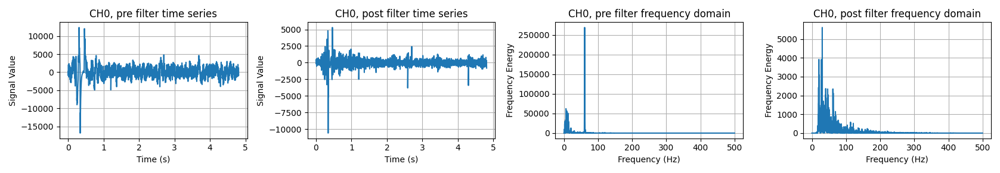
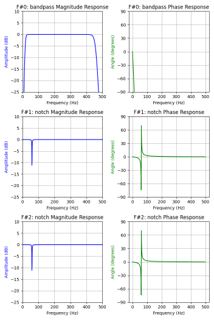

The EMG signal is inherently noisy, meaning it must be filtered before it is passed through the machine learning pipeline. This is because a noisy signal leads to worse classifier performance, and in turn, system performance and online usability. The filtering module, which is built on top of the scipy package, alleviates these challenges by providing developers with a simple tool for removing common sources of noise, such as: 

- **Powerline Interference:** 50/60 Hz noise, caused by proximity to wired electronic devices.
- **Motion Artifact:** <20 Hz noise, caused by the movement of the limb and, correspondingly, measurement equipment, changing the contact characteristics between the electrodes and the skin.

**Note that many hardware devices (such as the Myo and Delsys) have the option for built-in filtering.**

Filters are created with the `Filter` class (`libemg.filtering.Filter`), which takes the sampling frequency of the data, and are installed by passing a dictionary with the filter parameters to `install_filters`:
- **name:** The name of the filter: `"notch"`, `"lowpass"`, `"highpass"`, `"bandpass"`, `"bandstop"` or `"standardize"`.
- **cutoff:** The cutoff frequency in Hz (a list of two frequencies for `"bandpass"` and `"bandstop"`).
- **order/bandwidth:** The order of the Butterworth filter (`"lowpass"`, `"highpass"`, `"bandpass"`, `"bandstop"`), or the width in Hz of the `"notch"` filter.

The `"standardize"` filter instead takes a `"data"` key holding an OfflineDataHandler, and scales every channel to zero mean and unit variance using the statistics of that data.

```Python
from libemg.filtering import Filter

fi = Filter(sampling_frequency=1000)
# create a notch filter for removing power line interference
filter_dictionary={ "name": "notch", "cutoff": 60, "bandwidth": 3}
fi.install_filters(filter_dictionary)
# create a filter for removing high frequency noise and low frequency motion artefacts
filter_dictionary={ "name":"bandpass", "cutoff": [20, 450], "order": 4}
fi.install_filters(filter_dictionary)
# create a filter for low frequency motion artefacts
filter_dictionary={ "name": "highpass", "cutoff": 20, "order":2}
fi.install_filters(filter_dictionary)
```

Filters are applied in the order they were installed. `install_common_filters()` installs a 20-450 Hz bandpass filter (or a 20 Hz highpass filter if the sampling frequency is below 1000 Hz) followed by a 60 Hz notch filter. `visualize_filters()` shows the frequency response of the installed filters.

These filters can be applied to numpy arrays, the Offline Data Handler, or the Online Data Handler.

# Filtering Offline Data
It is often desirable to filter offline data to clean them up or for better recognition performance. The filtering module can be used directly on the OfflineDataHandler or a numpy array of EMG data (samples x channels) through the `.filter()` function. After installing the filters on the Filter class, simply just pass in the data and the filtering will be applied. An OfflineDataHandler is filtered in place (`filter` returns `None`), while a numpy array is returned filtered.

```Python
import libemg

dataset = libemg.datasets._3DCDataset()
odh = dataset.prepare_data(split=False, subjects=[0])
# instantiate the filter object with the sampling frequency
fi = libemg.filtering.Filter(1000)
# install filters to the filter object
fi.install_common_filters()
# run the entire first subject dataset through the common filters (in place)
fi.filter(odh)
```



<center> <p> Figure 1: A plot of the frequency domain before and after removing the 60 Hz powerline interference from a recording of data. </p> </center>

<!--  
<center> <p> Figure 2: TODO </p> </center> -->
<!-- I couldn't style this well, feel free to give it a shot. -->

# Filtering Online Data
Filters can be installed on the OnlineDataHandler to filter real-time (i.e., live) data. Once installed, the filters are applied to the EMG modality whenever data is read with `get_data` (unless `filter=False` is passed), so they are passed through the rest of the pipeline, for example, to the visualizations or the OnlineEMGClassifier. Data logged to file is not filtered.

```Python
from libemg.streamers import delsys_streamer
from libemg.data_handler import OnlineDataHandler
from libemg.filtering import Filter

if __name__ == "__main__" :
    fi = Filter(sampling_frequency=2000)
    fi.install_common_filters()

    streamer, shared_memory_items = delsys_streamer()

    # Create the Online Data Handler
    odh = OnlineDataHandler(shared_memory_items)
    # Install the Filters
    odh.install_filter(fi)

    odh.visualize()
```