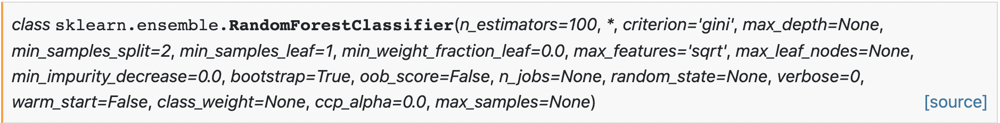

# Models

After recording, processing, and extracting features from a window of EMG data, it is passed to a machine learning algorithm for prediction. These control systems have evolved in the prosthetics community for continuously predicting muscular contractions for enabling prosthesis control. Therefore, they are primarily limited to recognizing static contractions (e.g., hand open/close and wrist flexion/extension) as they have no temporal awareness. This is the main form of recognition supported by LibEMG (the deep learning models in `libemg.deep` can also be trained to recognize discrete gestures) and is an initial step to explore EMG as an interaction opportunity for general-purpose use. This section highlights the machine-learning strategies that are part of `LibEMG`'s pipeline.

There are two types of models supported in `LibEMG`: classifiers and regressors. Classifiers output a discrete motion class for each window, whereas regressors output a continuous prediction along a degree of freedom. For both classifiers and regressors, `LibEMG` supports statistical models as well as deep learning models. Additionally, a number of post-processing methods (i.e., techniques to improve performance after prediction) are supported for all models.

## Statistical Models

The statistical models (i.e., traditional machine learning methods) implemented leverage the sklearn package. For most cases, the "base" models use the default options, meaning that the pre-defined models are not necessarily optimal. However, the `model_parameters` argument can be used when initializing the models to pass in additional sklearn parameters in a dictionary. For example, looking at the `RandomForestClassifier` docs on sklearn:



A classifier can be created with any of those parameters using the `model_parameters` argument (names that are not arguments of the sklearn model are reported and ignored). The model is then trained by passing `fit` a dictionary holding `training_features` and `training_labels`. For example:

```Python
from libemg.emg_predictor import EMGClassifier

parameters = {
    'n_estimators': 99,
    'max_depth': 20,
    'random_state': 5,
    'max_leaf_nodes': 10
}
classifier = EMGClassifier('RF', model_parameters=parameters)

# training_features: the dictionary returned by FeatureExtractor.extract_features,
# or an (N windows x N features) array
data_set = {'training_features': training_features, 'training_labels': training_labels}
classifier.fit(feature_dictionary=data_set)
predictions, probabilities = classifier.run(test_features)
```

`EMGClassifier` and `EMGRegressor` also accept `random_seed` (default 0), `fix_feature_errors` (default False; replaces NaN and infinite feature values with 0 before fitting and predicting) and `silent` (default False; hides the messages `fix_feature_errors` prints). A fitted model can be pickled with `classifier.save('model.pickle')` and reloaded with `EMGClassifier.from_file('model.pickle')`.

The same process can be done using the `RandomForestRegressor` from sklearn and an `EMGRegressor`. Please reference the [sklearn docs](https://scikit-learn.org/stable/) for parameter options for each model.

Additionally, custom models can be created. Any custom classifier should be modeled after the `sklearn` classifiers and must have the `fit`, `predict`, and `predict_proba` functions to work correctly. Any custom regressor should be modeled after the `sklearn` regressors and must have the `fit` and `predict` methods.

```Python
from sklearn.ensemble import RandomForestClassifier
from libemg.emg_predictor import EMGClassifier

rf_custom_classifier = RandomForestClassifier(max_depth=5, random_state=0)
classifier = EMGClassifier(rf_custom_classifier)
classifier.fit(feature_dictionary=data_set)
```

When a regressor is given as a string, `EMGRegressor` wraps it in sklearn's `MultiOutputRegressor`, so one model is fit per degree of freedom. A custom regressor is used as given, so it has to handle multi-output targets itself.

## Deep Learning (Pytorch)

Another available option is to use [pytorch](https://pytorch.org/) models (i.e., a library for deep learning). `libemg.deep` provides a ready-made `DeepModel` (MLP, CNN, transformer, GRU and LSTM architectures) that is trained on its own and then wrapped in an `EMGClassifier` or `EMGRegressor`; see the Deep Learning section. A custom pytorch model can also be used: call `fit(dataloader_dictionary=..., training_parameters=...)`, where the dictionary holds `training_dataloader` and `validation_dataloader` and `training_parameters` (optional) is a dictionary of keyword arguments, and the predictor calls the model's own `fit(dataloader_dictionary, **training_parameters)`. The same prediction methods (`predict`, plus `predict_proba` for classifiers) are expected of both deep and statistical classifiers/regressors.

## Online Prediction

`OnlineEMGClassifier` and `OnlineEMGRegressor` wrap a trained model and run it against live data in their own process. They are event driven. A write to the shared memory item a predictor consumes announces itself, the predictor is woken, and it then decides whether enough new samples have accrued to form a window. It no longer copies and filters the whole buffer to find that out.

None of this shows up in your code. The constructor arguments, the installed filters and the post-processing options are all unchanged. Where each prediction goes is set by the `output_writers` argument: a list of `libemg.output_writer` objects (for example `SocketOutputWriter`, `SharedMemoryOutputWriter` or `ConsoleOutputWriter`), each of which receives every prediction's information dictionary. What changes is the cost of running a predictor:

| Measurement | Value |
| ------------------ | ----------- |
| Sampling rate | 1000 Hz |
| Channels | 8 |
| Window size | 200 |
| Window increment | 50 |
| CPU used by the streaming process, original polling loop | 93.7% |
| CPU used by the streaming process, event-driven loop | 10.7% |
| Latency, last sample of a window to a prediction on the wire | 0.57 ms mean |

Those runs produce the same predictions, with a bandpass and a notch filter installed on the data handler.

One case keeps the original loop. If you have replaced `window_trigger_function_handle` with your own predicate, that loop is used automatically, because an arbitrary predicate cannot be restated as a per-item criterion. Setting `classifier.reactive = False` selects the original loop explicitly.

For the mechanism behind this, and for hooking your own stages into the same notifications, see the Reactive Pipelines section.
