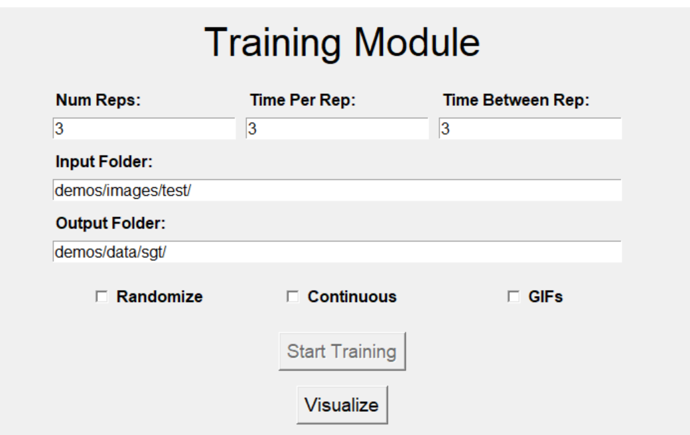
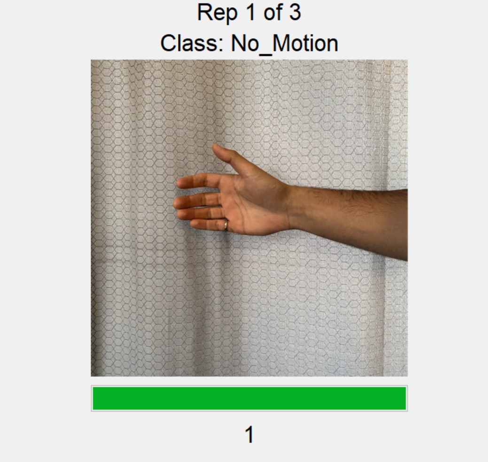
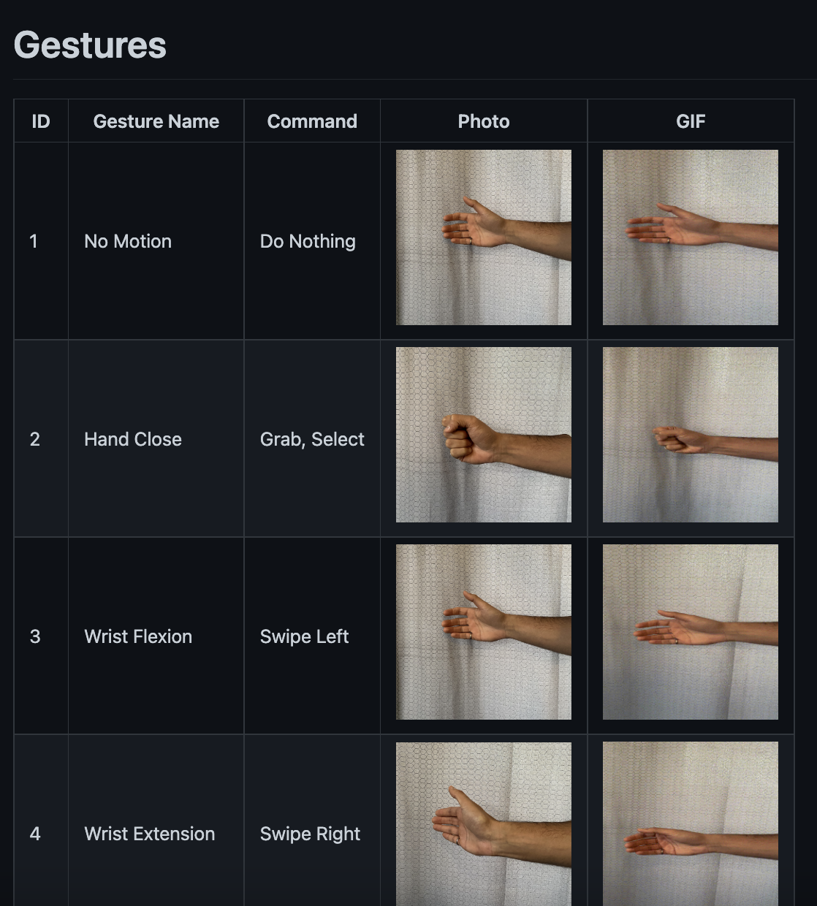
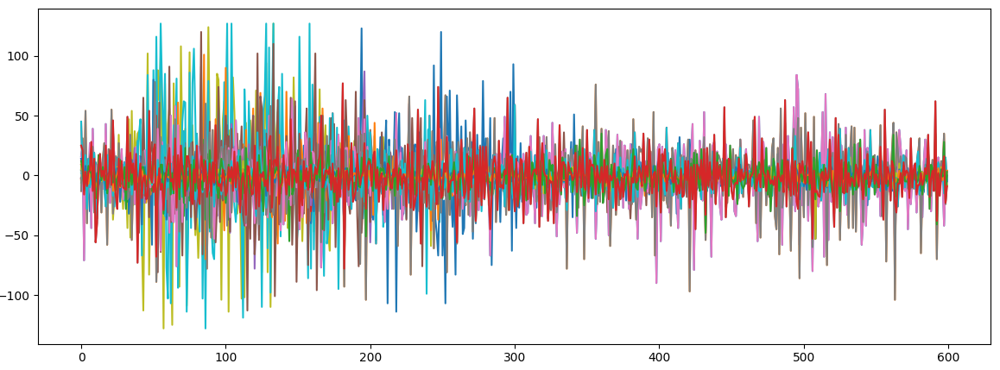
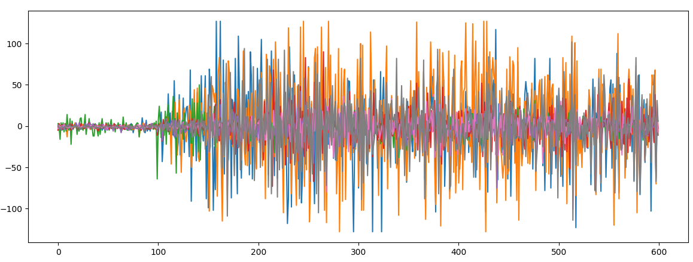

<style>
    table {
        width: 100%;
    }
</style>

Although not directly part of the EMG pipeline, the `Screen Guided Training` module provides developers a convenient means to collect real-time screen-guided training (SGT) data. This SGT data can be used to train a system (i.e., machine learning model) or for future offline analyses. Note that the SGT tool can handle image types of `png`, `jpg`, and `jpeg`. Additionally, it can handle `.gifs` for dynamic movements/contractions.

| <center>Menu</center>  | <center>SGT</center> |
| ------------- | ------------- |
|  |  |
<center> <p> Table 1: Screen Guided Training UI</p> </center>


# Gesture Library
One of the tedious aspects (and annoyances) of performing data collection is the need to accumulate photos (or videos) of each contraction. This process is not only time-consuming but also leads to inconsistencies among studies. To streamline this process, LibEMG includes a database of [~35 gestures](https://github.com/libemg/LibEMGGestures) (both static and dynamic) that can be interfaced and downloaded through the API.


<center> <p> Figure 1: A screenshot of the first four gestures of the <a href="https://github.com/libemg/LibEMGGestures"> gesture library </a>. Each gesture includes an index, a static image, and a dynamic gif. </p> </center>

Each gesture in the library is associated with a unique id that is referenced when specifying the gestures to download. A simple pipeline for setting up the SGT module is as follows: 

```Python
from libemg.gui import GUI
from libemg.data_handler import OnlineDataHandler
from libemg.streamers import myo_streamer

# Create data handler and streamer 
_, sm = myo_streamer()
odh = OnlineDataHandler(sm)

training_ui = GUI(self.odh, width=700, height=700, gesture_height=300, gesture_width=300)
training_ui.download_gestures([1,2,3,4,5], "images/")
training_ui.start_gui()
```

# Types of Training 
In general, the accumulation of training data can be split into one of two types: <b>static reps</b> and <b>ramp reps</b>. While ramp reps often lead to better performance, both training methods are viable. Static contractions involve eliciting the contraction for the entire rep duration. In this case, there is little variability other than that occurring throughout the contraction's duration. Ramp contractions start at rest and involve a transition to the contraction within the rep duration. This captures a range of variability for each contraction, which is crucial for velocity-based control systems. Table 2 highlights the differences between the two strategies. 

**Note, that when using velocity control, ramp contractions should be used.**

| <center>Type</center>  | <center>EMG</center> |
| ------------- | ------------- |
|  <center><b>Static</b></center> |  |
|  <center><b>Ramp</b></center> |  |
<center> <p> Table 2: Static training repetition (top) compared to a ramp training repetition (bottom). </p> </center>

# Subject Details
The configuration window has a **Subject Details** section: subject number, subject name, session number, day number and condition number. Whatever it is showing when Start is pressed is written to `subject_details.yaml` in the output folder, alongside the data:

```yaml
subject_number: 7
subject_name: Ada
session_number: 2
day_number: 3
condition_number: 4
collected: '2026-09-18T14:02:11.418293'
```

This is what a dataset has to be grouped by later, and it is the one thing in the folder that cannot be recovered from the recording itself -- so it is written before the first repetition rather than left to a lab notebook. It is kept out of `collection_details.json` because the two go stale at different times: that file describes the prompts a run happened to use, this one describes the person and the condition. YAML because it is the file most likely to be opened and corrected by hand.

The fields can be seeded from the GUI's `args` so a rig set up for one participant opens on the right numbers:

```Python
training_ui = GUI(odh, args={'media_folder': 'images/', 'data_folder': 'data/S07/',
                             'subject_number': 7, 'subject_name': 'Ada',
                             'session_number': 2, 'day_number': 3, 'condition_number': 4})
```

A numbered field that is not a number is written through as typed, so a study labelling its subjects `P01` works and a blank field does not abort the collection at the moment Start is pressed.


# Designing the Protocol

Most of what decides whether a collection produces usable data is fixed before anyone contracts a muscle: what is prompted, in what order, for how long, with what rests, under what conditions, and against what acquisition settings. Those decisions used to live in whichever script launched the GUI, in the alphabetical order of a media folder, and in a lab notebook.

**Data > Collection Protocol** makes them a document. The panel builds a `CollectionProtocol`, renders its prompts with the `Animator`, and hands both to screen guided training. The protocol is saved into the data folder, so a recording carries the description of the experiment that produced it.

```Python
from libemg.protocol import CollectionProtocol, within_and_combined_dof

protocol = CollectionProtocol(name='wrist-2dof', kind='regression',
                              dof_labels=['Flexion/Extension', 'Pronation/Supination'],
                              factors={'limb_position': ['neutral', 'elevated', 'across body']})
protocol.trajectory = within_and_combined_dof(n_dof=2, hold_seconds=3, ramp_seconds=2)
protocol.save('wrist-2dof.yaml')
protocol.build_media('animation/')     # writes the video and its per-frame labels
```

Or from a terminal:

```
python -m libemg.protocol template study.yaml --dofs Flex Extend
python -m libemg.protocol show study.yaml
python -m libemg.protocol build study.yaml --media-folder animation/
```

## The trajectory

A prompt trajectory is a list of segments — `rest`, `ramp`, `hold`, `sinusoid`, `random` — rendered end to end. Each segment starts where the last one finished, so there is never a jump the subject cannot follow, and a `rest` releases over a quarter of a second rather than snapping to zero. The animation's own coordinates are written beside the video as a `.txt`, which screen guided training already picks up as per-frame labels, so a regression collection comes out with its ground truth aligned to its prompts.

Three templates are built in, each matching a standard prompt in the literature:

| Template | What it prompts | What it is for |
| --- | --- | --- |
| Within and combined DOF | each DOF ramped to both extremes alone, then the pairs driven together | proportional control, which exists for the simultaneous case a within-DOF-only training set never shows |
| Ramp and hold | one DOF ramped to a series of intensity levels | pacing the contraction, and covering more than the single effort level a classifier would otherwise be trained at |
| Random exploration | randomly placed targets inside the unit ball | the space between the axes, which is most of where a user actually operates |

An animated prompt matters even for classification. A static image says what to do but not how hard or how fast, so the contraction profile is whatever the subject felt like; a prompt that ramps to a level and holds paces them. This is the same recommendation as the ramp contractions described above, generated rather than described.

## Order, rests and design factors

| Setting | Default | Why |
| --- | --- | --- |
| Order | `random` | Collecting class 1 first and class 8 last in every rep confounds class with everything that drifts over a session: fatigue, gel drying, skin impedance, the subject settling in. `counterbalanced` rotates instead, so every class sits in every position. |
| Seed | recorded | An order that cannot be reproduced cannot be reported. The seed is saved with the protocol. |
| Rest jitter | 1.0 s | A rest of exactly three seconds teaches the subject when the prompt is coming, and they pre-empt it — the onset then sits before the cue and the start of the rep is not what it is labelled. |
| Design factors | none | Accuracy falls when the limb is in a position, or the contraction at an intensity, that was not in the training set. Levels are declared here, varied between reps (a subject cannot change arm position mid-rep), shown in the prompt, and written into every stage of `_session_annotations.json`. |
| Reaction time | 0.2 s | Recorded, not applied. The recording is continuous and the annotations mark the cue, so trimming the reaction delay is a decision for analysis rather than one baked into the files. |

## Acquisition details

The **Acquisition (ISEK reporting)** section collects what the ISEK standards for reporting EMG ask for: electrode type, size, inter-electrode distance, placement, skin preparation, ground location, sampling rate, amplifier bandwidth, notch, gain and A/D resolution. None of it can be recovered from the recording afterwards, and all of it decides whether the data can be compared with anyone else's. `protocol.describe()` says how many fields are still blank.

# Checking the Signal First

Most unusable EMG datasets were unusable from the first repetition, and nothing in the recording says so. A disconnected channel writes a flat line, a loose electrode writes artifact, a badly grounded rig writes mains hum, and an over-gained amplifier writes a clipped square wave — all four look like data, and all four are found weeks later in analysis.

The configuration window has a **Check Signal** button, and the same check runs when Start is pressed. It reports dead channels, clipping, mains pickup at 50 or 60 Hz, and channels far out of balance with the rest, and it measures the rate the device is *actually* delivering rather than the one it was configured for. The result is written to `signal_quality.yaml` in the data folder, so the state of the electrodes at the start of the session is part of the record.

```Python
from libemg.signal_quality import check_signal

report = check_signal(odh.get_data()[0]['emg'], sampling_rate=1000)
print(report.summary())
```

```
emg: 8 channels, 2000 samples (2.0 s at 1000 Hz)
  ! Channel(s) 3 are effectively flat next to the others. Check those leads are seated before collecting.
  ! Channel(s) 6 carry heavy 60 Hz mains pickup (62% of in-band power). Check the ground electrode ...
```

Everything is measured relative to the signal itself rather than in microvolts, since a LibEMG stream carries whatever units its device chose. Pass `signal_check='block'` to refuse to start on a bad signal, or `'off'` to skip it; the default warns and collects anyway, because a heuristic should not be able to cancel a booked session hour.

At the end of a session the median frequency of the first repetition is compared against the last. A drop is the shift a fatiguing muscle makes, and it means the later repetitions are not quite the same task as the earlier ones — worth knowing before the data is treated as one homogeneous set.


# Continuous Collection
A collection is recorded in one piece. Every sample the device delivers between pressing Start and the final repetition ending goes into `_session_<modality>.csv` -- the prompts, the grey rest screens in front of them, and the pauses where the collection waits for someone to press Continue. Nothing is dropped for falling outside a repetition.

This matters for two reasons. Starting and stopping a log around each repetition cuts the stream on the time samples *arrived*, and a device does not deliver on a schedule: the tail of a repetition is still in flight when its log stops, while a burst landing early in a window carries samples produced during the preceding rest. Neither is lost data -- both are samples credited to the wrong repetition, and both disappear when the stream is never cut while it is running. And a temporal model that wants to read a longer stream than one repetition, through the transition into and out of a contraction, needs the stretch between repetitions to exist.

Alongside the recording, the collection writes `_session_annotations.json`: one entry per stage, with the wall-clock time it ran and the sample indices it occupies in each modality's file. It is written after every stage, so a collection that is interrupted still leaves a file describing what reached the disk. The standard `C_<class>_R_<rep>_<modality>.csv` files are then cut from the recording at those indices -- so the same cut can be made again later, differently, without collecting again.

```Python
from libemg.session import SessionAnnotations

session = SessionAnnotations.load('data/_session_annotations.json')

# Cut it again: keep the rest periods this time, with a quarter second of
# context either side of every prompt.
session.cut('data/recut/', kinds=('prompt', 'rest'), lead_in=0.25, lead_out=0.25)

# Or read a modality end to end and ask what each part of it was. The spans
# tile the recording with no gaps between them.
arrivals, emg = session.read('emg')
for span in session.timeline('emg'):
    print(span.kind, span.label, span.start, span.end)
```

The same thing from a terminal:

```
python -m libemg.session show data/_session_annotations.json
python -m libemg.session cut data/_session_annotations.json --kinds prompt rest --lead-in 0.25
```

A stage is one of `prompt` (a repetition), `rest` (the grey screen before one) or `pause` (the hold on Redo/Continue). Only prompts are cut by default, and only prompts are named `C_<class>_R_<rep>_`; a rest or a pause is written under a name carrying no `C_`/`R_` tokens, so a regex parser pointed at the folder cannot mistake one for a repetition. A repetition that was redone stays in the annotations marked `superseded`, since those samples are still in the recording, but it is not cut unless asked for.

Passing `'continuous_log': False` in the GUI's `args` restores the old behaviour of a separate log per repetition, with no session file and no annotations.
