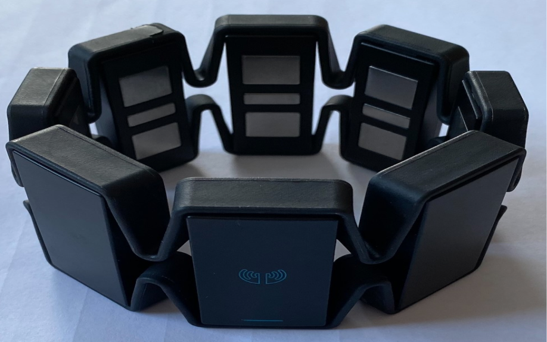
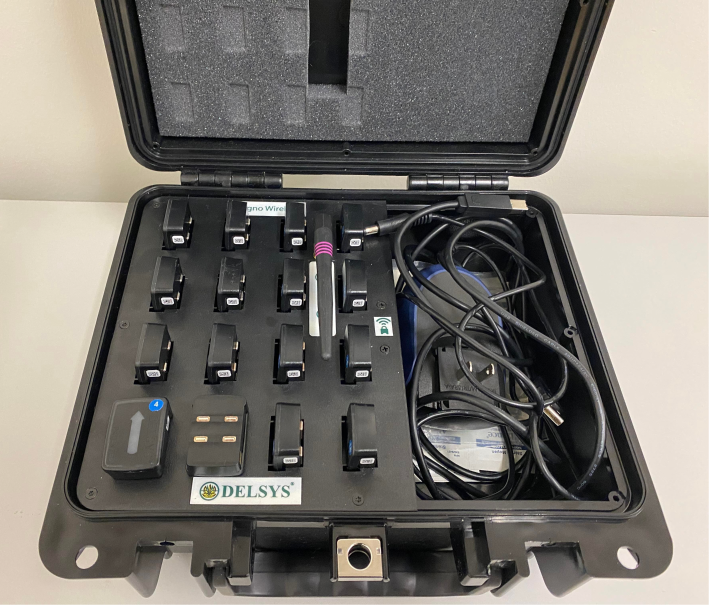
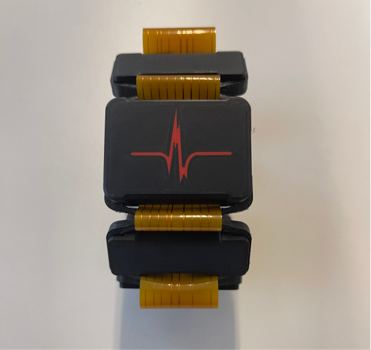
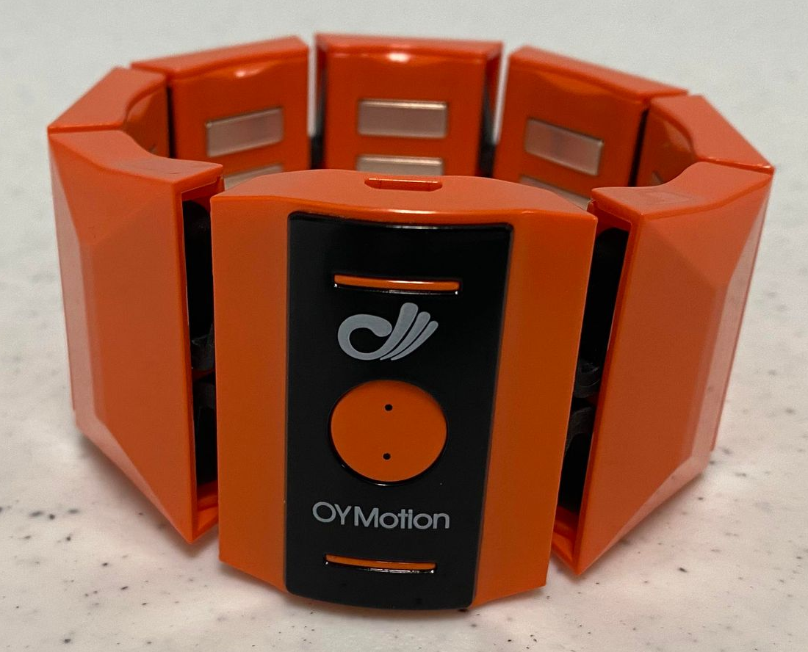
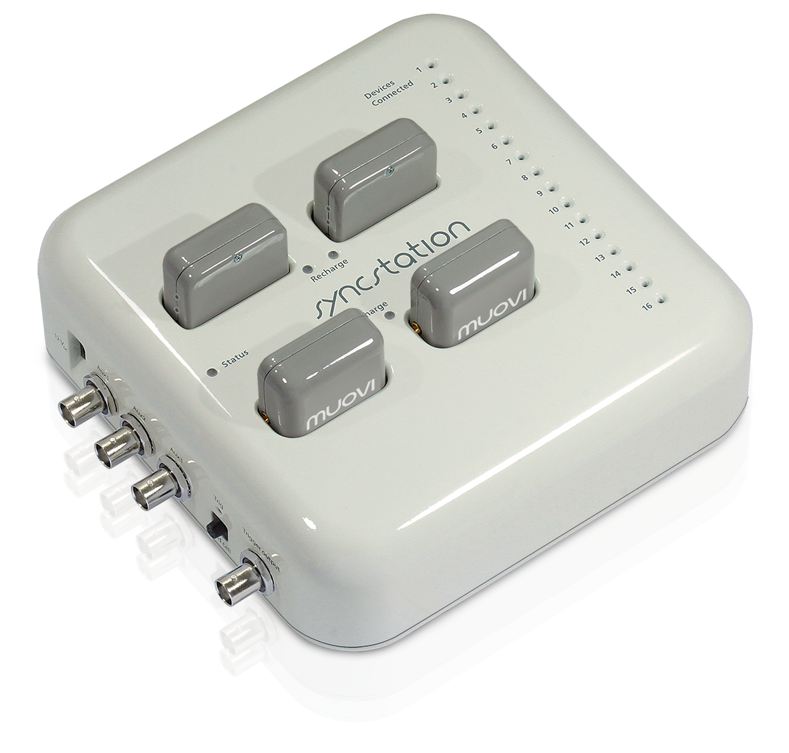
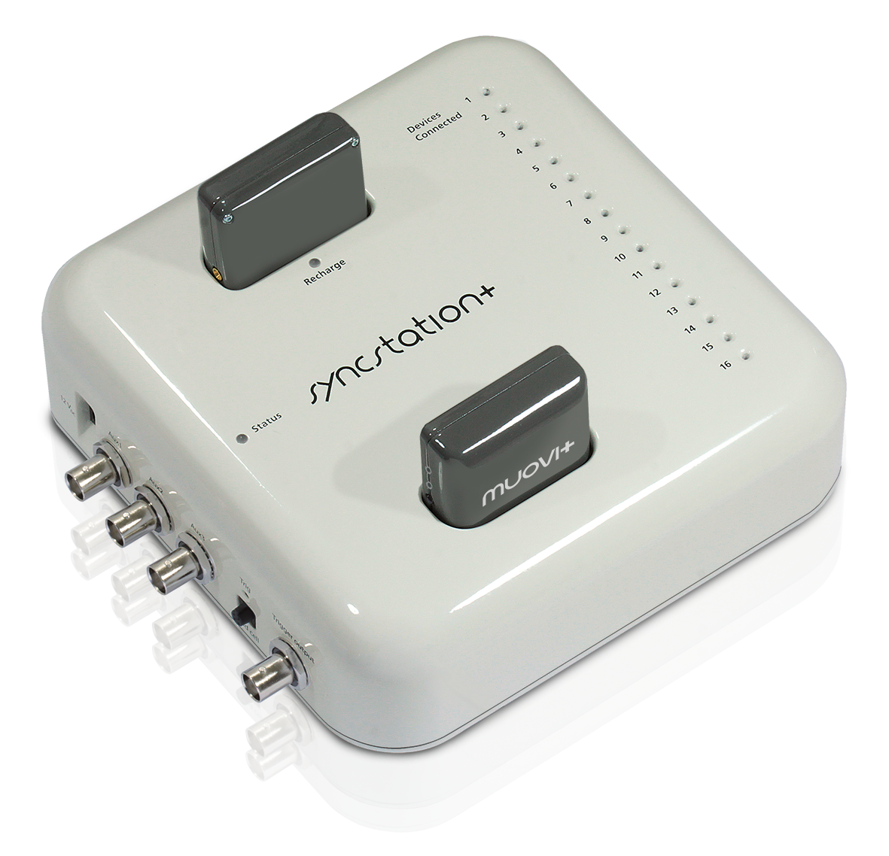
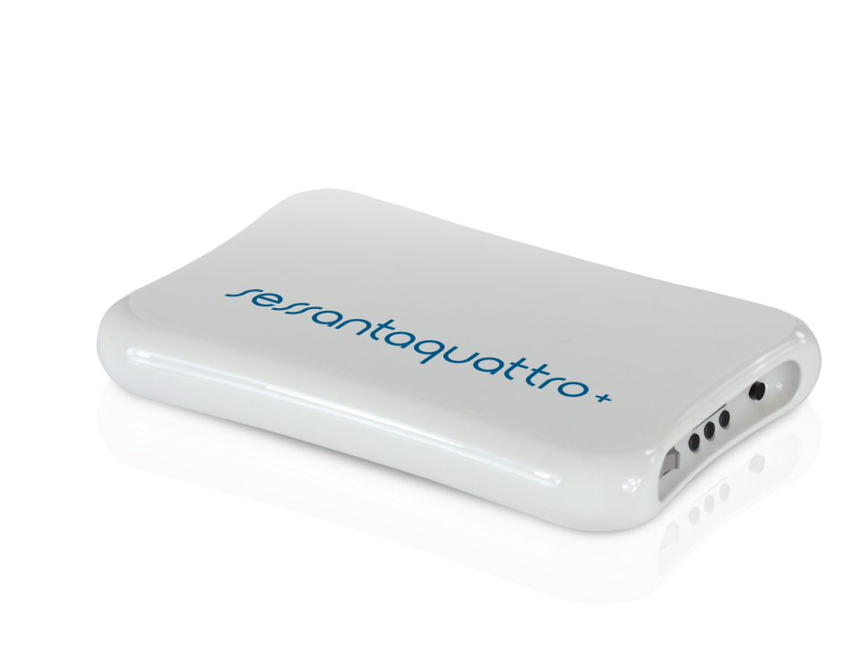

<style>
    table {
        width: 100%;
    }
    .device_img {
        display: block;
        margin-left: auto;
        margin-right: auto;
        width: 50%;
        height: 50%;
    }
    .device_img_2 {
        display: block;
        margin-left: auto;
        margin-right: auto;
        width: 35%;
        height: 50%;
    }
</style>

By default, LibEMG supports several hardware devices (shown in Table 1). 
- The **Myo Armband** is a previously available commercial device popular for HCI applications due to its low cost.
- The [**Delsys**](https://delsys.com/) is a commercially available system primarily used for medical applications due to its relatively high cost. 
- The [**SiFi Labs**](https://sifilabs.com/) **BioArmband** (an 8-channel EMG cuff) and **BioPoint** (a single-channel EMG sensor) stream through SiFi Bridge. Compared to the Myo armband, these devices have a much higher sampling rate (EMG at up to 2000 Hz; the defaults are 1600 Hz for the BioArmband and 2000 Hz for the BioPoint), and can also record ECG, EDA, IMU, PPG and skin temperature.
- The [**Oymotion Cuff**](http://www.oymotion.com/en/product32/149) is a commercial device that samples EMG at 1000 Hz (8 bits) or 500 Hz (12 bits). 
- The **EMaGer** is a 64-channel high-density EMG armband that streams over a serial (USB) connection.
- The **Leap Motion** hand tracker is not an EMG device, but its hand and finger tracking can be streamed alongside EMG (e.g., as ground truth for regression).
<!-- - The [**OTBioelettronica**](https://otbioelettronica.it/hardware/) devices are a set of commercially available HDEMG systems. -->

If selecting EMG hardware for real-time use, wireless armbands that sample above 500 Hz are preferred. Devices with Inertial Measurement Units (IMUs) enable more interaction opportunities, and the Myo, Delsys, SiFi and Oymotion streamers can forward IMU data alongside EMG (pass `imu=True`).

Every streamer function starts the device in a separate process and returns two values: the streamer process and the list of shared memory items to pass to the `OnlineDataHandler`. Each modality is stored under its own key (e.g., `'emg'`, `'imu'`), along with a matching `'<key>_count'` sample counter. The `shared_memory_items` argument of each streamer overrides the default buffer sizes.

```Python
from libemg.streamers import sifi_bioarmband_streamer
from libemg.data_handler import OnlineDataHandler

if __name__ == "__main__":
    streamer, shared_memory_items = sifi_bioarmband_streamer(emg=True, imu=True)
    odh = OnlineDataHandler(shared_memory_items)
```

| <center>Hardware</center> | <center>Function</center> | <center>Image</center> |
| ------------- | ------------- | ------------- |
| Myo Armband  | `myo_streamer()`  | <div class="device_img"> </div>|
| Delsys  | `delsys_streamer()` (Trigno Control Utility) or `delsys_api_streamer(license, key, num_channels)` (Delsys C#.NET API) | <div class="device_img_2"> </div>|
| SiFi BioArmband / BioPoint | `sifi_bioarmband_streamer()` / `sifi_biopoint_streamer()` | <div class="device_img"> </div>|
| Oymotion | `oymotion_streamer()`| <div class="device_img"> </div>|
| EMaGer | `emager_streamer()` | |
| Leap Motion | `leap_streamer()` | |
<!-- | Muovi | `otb_muovi_streamer()`| <div class="device_img"> </div>| 
| Muovi+ | `otb_muovi_plus_streamer()`| <div class="device_img"> </div>| 
| Sessantaquattro+ | `otb_sessantaquattro_plus_streamer()`| <div class="device_img"> </div>|  -->

<center> <p>Table 1: The list of all implemented streamers.</p> </center>

## Inspecting Hardware
LibEMG includes an `analyze_hardware` function on the `OnlineDataHandler` to run an analysis on the hardware device being used. This is a good way to  check that your device is working as expected. Example output from this function for the Myo Armband is:

```Python
from libemg.streamers import myo_streamer
from libemg.data_handler import OnlineDataHandler

if __name__ == "__main__":
    streamer, sm = myo_streamer()
    odh = OnlineDataHandler(sm)
    odh.analyze_hardware()
```

```
Starting analysis (10s)... We suggest that you elicit varying contractions and intensities to get an accurate analysis.
--------- emg ---------
Sampling Rate: 200
Num Channels: 8
Max Value: 127
Min Value: -128
Resolution: 8 bits
Analysis sucessfully complete. ODH process has stopped.
```

The analysis is printed for every modality in the shared memory (e.g., `emg` and `imu`), and `analyze_time` (default 10 seconds) sets how long the device is analyzed for.

- `sampling rate` is the number of samples read per second.
- `num channels` is the number of channels being read.
- `min and max values` are the minimum and maximum values read from the data.
- `resolution` is the predicted resolution in bits based on the number of unique values seen.

To check the quality of the signal itself (dead channels, clipping, mains interference and channel imbalance), pass a few seconds of data to `check_signal` from `libemg.signal_quality`:

```Python
from libemg.signal_quality import check_signal

report = check_signal(odh.get_data()[0]['emg'], sampling_rate=200)
print(report.summary())
```

## Creating Custom Streamers
Custom streamers can be created to interface with other hardware. A streamer is a process that reads samples from a device and writes them into shared memory, and the `OnlineDataHandler` (and the rest of the online pipeline) attaches to that shared memory using the shared memory items the streamer returns. Each modality needs a buffer (`[key, (buffer_size, num_channels), dtype]`) and a matching `[key + '_count', (1, 1), np.int32]` counter, and `assign_shared_memory_locks` gives each pair a shared lock. An example streamer is shown in the code snippet below.

The default streamers write into shared memory with `SharedMemoryManager.commit`. One call stores the new samples, advances the item's state block and wakes anything hooked into that item, all under a single acquisition of the item's lock. A custom streamer that writes the same way gets those notifications for free, and the online classifier and any installed hooks pick its data up without further work. See the Reactive Pipelines section for what is being notified.

<details>
<summary><b>Example Code</b></summary>

```Python
import numpy as np
from multiprocessing import Process
from libemg.shared_memory_manager import SharedMemoryManager, assign_shared_memory_locks
from libemg.reactive import default_notifier_pool
from libemg.data_handler import OnlineDataHandler

class MyStreamer(Process):
    def __init__(self, shared_memory_items):
        super().__init__(daemon=True)
        self.shared_memory_items = shared_memory_items

    def run(self):
        # Create the shared memory in the streamer process
        smm = SharedMemoryManager(notifier_pool=getattr(self, "notifier_pool", None))
        for item in self.shared_memory_items:
            smm.create_variable(*item)

        while True:
            # Replace this with a read from your device (one row per sample, oldest first)
            sample = np.random.randn(8)
            # Store the sample, advance the counter and notify any observers
            smm.commit("emg", sample)

def my_streamer():
    shared_memory_items = [["emg",       (1000, 8), np.double],
                           ["emg_count", (1, 1),    np.int32]]
    assign_shared_memory_locks(shared_memory_items)
    streamer = MyStreamer(shared_memory_items)
    # Share the notifier pool with the streamer process so its commits can wake observers
    streamer.notifier_pool = default_notifier_pool()
    streamer.start()
    return streamer, shared_memory_items

if __name__ == "__main__" :
    streamer, shared_memory_items = my_streamer()

    # Code leveraging the data goes here:
    odh = OnlineDataHandler(shared_memory_items)

    # Do stuff with data...
```

</details>

<br/>
<br/>
