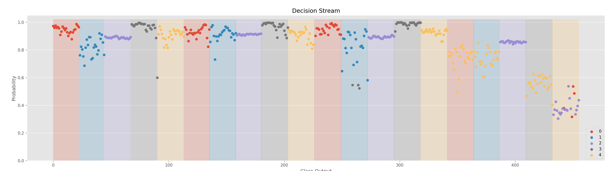
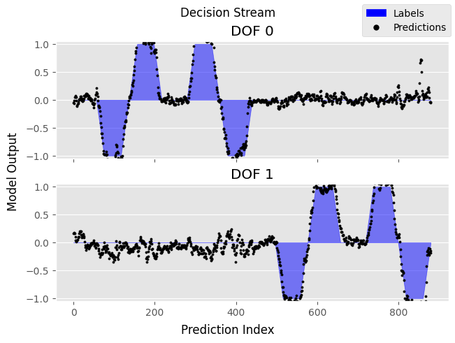
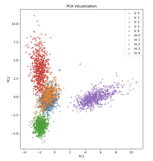
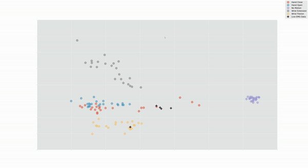
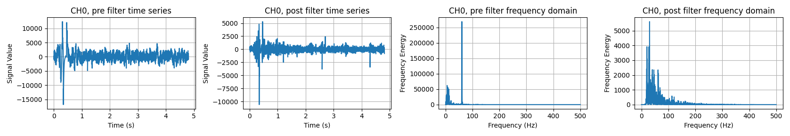

# Online Data Handler
There is different convenient functionality in the `OnlineDataHandler` to help developers. Firstly, two visualize functions: `visualize` and `visualize_channels`, exemplified in Figure 1 are included. `visualize(num_samples=500, block=True)` plots every channel of every modality together, and `visualize_channels(channels, num_samples=500)` plots the listed EMG channels (indexed from 0). Both show the most recent `num_samples` samples, with any installed filters applied.

```Python
from libemg.streamers import myo_streamer
from libemg.data_handler import OnlineDataHandler

if __name__ == "__main__":
    streamer, sm = myo_streamer()
    odh = OnlineDataHandler(sm)
    odh.visualize()
    # or: odh.visualize_channels(channels=[0, 1, 2, 3])
```

| <center>Combined</center>  | <center>All Channels</center> |
| ------------- | ------------- |
|   |    |
<center> <p> Figure 1: Raw Data from the <b>OnlineDataHandler</b></p> </center>

These plots redraw on a timer, and each frame copies the whole buffer out of shared memory. For a cheaper look at live data, install a probe hook instead. A `ProbeHook` carries a `Periodic(hz)` criterion and declares no outputs, so it is woken at most `hz` times a second and nothing downstream waits on it. A probe cannot stall or alter the pipeline it watches, which makes it the safe way to observe a running control system.

```Python
from libemg.reactive import ProbeHook

odh.install_hook(ProbeHook('watch', 'emg', print, hz=30))
odh.start_hooks()
...
odh.stop_hooks()
```

Pass your own function in place of `print` to draw, log, or forward the samples. See the Reactive Pipelines section for the other criteria and hooks.

# EMG Classifier 
The EMG classifier contains a visualization tool for viewing the decisions stream (i.e., the predictions over time) for a particular classifier using the `visualize` function. For an offline `EMGClassifier`, pass in the test labels and the predictions and probabilities returned by `run` (`clf.visualize(test_labels, predictions, probabilities)`). An `OnlineEMGClassifier` also has a `visualize` method that shows a live plot of its decisions (it must be outputting probabilities). 



<center> <p> Figure 2: The decision stream of a classifier.</b></p> </center>

# EMG Regressor

The EMG regressor also contains a visualization tool for viewing the model's decision stream. Similar to the classifier, you can view the decision stream using the `visualize` method (`reg.visualize(test_labels, predictions)`, with one column per degree of freedom). `OnlineEMGRegressor` also provides a live `visualize` method.


<center> <p> Figure 3: The decision stream of a regressor.</b></p> </center>

# Feature Extractor 
The Feature Extractor contains a visualization tool for viewing the feature space through a 2D projection. This can be done using the `visualize_feature_space(feature_dic, projection, classes=None, test_feature_dic=None, t_classes=None)` function, where `projection` is one of `'pca'`, `'kernelpca'`, `'ica'`, `'lda'`, `'tsne'` or `'isomap'` (see Figure 4). Test features can be overlaid on the training features with `test_feature_dic`. The live (online) version shown in Figure 4 was provided by the Online Data Handler in earlier versions and is not currently available.

| <center>Offline</center>  | <center>Online (Live)</center> |
| ------------- | ------------- |
|   |  |
<center> <p> Figure 4: The PCA feature space of a set of data.</p> </center>

# Filtering 
The filtering module has a `visualize_effect` function that demonstrates the effect of the installed filters on a set of data (a numpy array of samples x channels) in the time and frequency domain. `visualize_filters` shows the magnitude and phase response of the installed filters.


<center> <p> Figure 5: Data before and after filtering in the time and frequency domain.</p> </center>

# Heatmap

Viewing EMG as a time series may not be appropriate for high-density EMG systems. `LibEMG` offers a live heatmap visualization using the `visualize_heatmap` method of the `OnlineDataHandler`. Heatmaps of multiple features can be visualized in real-time to show spatial information (only features that produce a single value per window are supported). Features are extracted from the most recent `num_samples` samples (default MAV), and `remap_function` reshapes the per-channel values into the electrode grid. Before the plot opens, the stream is analyzed for 5 seconds to find the range of each feature, so rest and then perform a maximal contraction during that time.

```Python
import numpy as np

odh.visualize_heatmap(num_samples=200, feature_list=['MAV', 'RMS'],
                      remap_function=lambda x: np.reshape(x, (-1, 4, 16)))  # e.g., 64 channels -> 4 x 16 grid
```


<center> <p> Figure 6: Real-time heatmap visualization.</p> </center>
