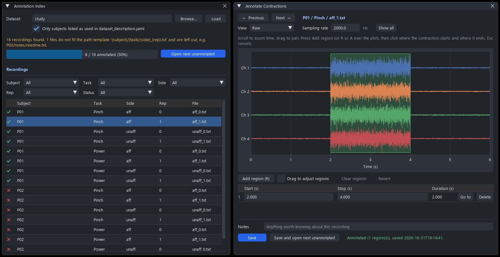

A recording made with screen guided training knows when each contraction was cued, because the collection wrote the cue times into `_session_annotations.json`. A recording made any other way does not: a clinic's recordings, an older dataset, a session where the subject started late or relaxed early. Before such a recording can train a model, someone has to look at it and mark where the contractions actually are.

**Data > Annotate Contractions** does that, one recording at a time, across a whole dataset. This example takes a folder of recordings, marks the contractions in each, and then uses the marks to train a classifier in Python.


<center> <p> The index of every recording on the left, and the open recording on the right with one region marked.</p> </center>

# The dataset

The panel works on a folder of delimited text recordings, one file per recording, one row per sample and one column per channel. Here the folders say who and what each file is:

```
study/
    dataset_description.yaml
    P01/
        Pinch/
            aff_0.txt
            aff_1.txt
            unaff_0.txt
            unaff_1.txt
        Power/
            ...
    P02/
        ...
```

Which files are recordings, and what their folders mean, is read from `dataset_description.yaml` at the root. Every key is optional.

```yaml
used_subjects:            # top-level folders to include
  - "P01"
  - "P02"
annotation:
  data_files: "*/*/*.txt"                          # glob(s) under the root; default **/*.txt
  exclude_files:                                   # glob(s) to leave out
    - "*/practice/*"
  path_template: "{subject}/{task}/{side}_{rep}.txt"
```

| Key | What it does |
| --- | --- |
| `used_subjects` | Leaves out every other top-level folder. The panel has a checkbox to show them anyway. |
| `data_files` | Which files are recordings. `*` stays within one folder and `**` spans any number of them. |
| `exclude_files` | Files the globs pick up that are not recordings. |
| `path_template` | Names the parts of a recording's path. Each name becomes a column of the index and a filter above it. A file that does not fit the template is left out and listed, so a stray file is noticed rather than silently annotated or silently skipped. |

Without a template, the first folder is taken as the subject and the rest of the path as the folder. Without a description at all, every `.txt` file under the root is a recording.

# Opening the panel

Choose **Data > Annotate Contractions**, type or browse to the dataset folder, and press **Load**. The folder and sampling rate can also be given when the GUI is opened, which is convenient when the same dataset is annotated over several sittings:

```Python
from libemg.gui import GUI

if __name__ == "__main__":
    GUI(args={'annotation_folder': 'study/',
              'sampling_rate': 2000.0}).start_gui()
```

No device has to be started. The panel only reads files.

The **Annotation Index** window lists every recording with a tick if it has been annotated and a cross if it has not, and a progress bar over the whole dataset. The filters above the table narrow it by any field the path template names, and by status. **Open next unannotated** opens the first recording that has not been looked at, so annotating a dataset is a matter of pressing one button after each file.

# Marking a contraction

Clicking a row opens the recording in the **Annotate Contractions** window. Every channel is drawn on its own row, each scaled to its own spread.

| To | Do |
| --- | --- |
| Zoom in time | Scroll over the plot. **Show all** zooms back out. |
| Pan | Drag the plot. |
| Mark a region | Press **Add region** (or **R** or **A** with the pointer over the plot), click where the contraction starts, then click where it ends. **Esc** cancels. |
| See the onset more clearly | Set **View** to **RMS envelope**, a 100 ms moving RMS of each channel. |
| Move a region's edges | Tick **Drag to adjust regions** and drag them, or type the times in the region table. |
| Remove a region | **Delete** on its row in the table, or **Clear regions** for all of them. |
| Leave a note | Type it under **Notes**. It is saved with the regions, for whoever reads the recording next. |

**Save** writes the regions. **Save and open next unannotated** writes them and moves on. Moving to another recording with unsaved changes asks whether to save or discard them, and **Revert** returns to what was last saved.

A recording with no usable contraction is still worth saving, with no regions and perhaps a note. An annotation with no regions says the recording was looked at and holds nothing to train on. A recording that has not been looked at has no annotation file at all, so the two cannot be confused.

The **Sampling rate** box only changes what the time axis reads. Text recordings do not carry their sampling rate, so the regions are saved in samples, and they stay correct whatever rate is assumed later.

# What is saved

Each recording's regions go in a small JSON file beside it, `aff_0.txt` to `aff_0.annotations.json`:

```json
{
  "file": "aff_0.txt",
  "num_samples": 12000,
  "sampling_rate": 2000,
  "regions": [
    {"start": 4000, "stop": 8000}
  ],
  "notes": "",
  "updated": "2026-10-31T19:14:41"
}
```

`start` and `stop` are sample indices, with `stop` exclusive, so `data[start:stop]` is the contraction. Regions that overlap or touch are merged when saved, since two marks over the same samples are one contraction. The file is written to a temporary name and moved into place, so a crash mid-write cannot leave a half-written file that reads as annotated. Because the annotations live beside the data rather than in one central file, a dataset can be split between several people and their work merged by copying folders.

# Using the annotations in Python

`libemg.annotations` reads the same description and the same files. `DatasetIndex.scan` lists the recordings exactly as the panel does, and each entry loads its annotation.

```Python
import numpy as np
from libemg.annotations import DatasetIndex, load_emg_text

index = DatasetIndex.scan('study/')
print(index.field_names)        # ['subject', 'task', 'side', 'rep']
print(index.progress())         # (annotated, total)
print(index.unmatched)          # files the globs found that do not fit the template
```

Each entry carries the fields its path named, under `entry.fields`, and `load_annotation()` returns its `ContractionAnnotation`, or `None` if nobody has looked at it yet. From there the marked regions are ordinary slices of the recording, ready to window and extract features from:

```Python
from libemg.utils import get_windows
from libemg.feature_extractor import FeatureExtractor
from libemg.emg_predictor import EMGClassifier

fe = FeatureExtractor()
tasks = sorted({entry.fields['task'] for entry in index.entries})

features, labels = [], []
for entry in index.entries:
    annotation = entry.load_annotation()
    if annotation is None:              # not annotated yet
        continue
    data = load_emg_text(entry.path)
    for start, stop in annotation.regions:
        windows = get_windows(data[start:stop], 400, 100)    # 200 ms windows at 2 kHz
        features.append(fe.extract_features(['MAV', 'WL', 'ZC', 'SSC'], windows, array=True))
        labels.append(np.full(len(windows), tasks.index(entry.fields['task'])))

classifier = EMGClassifier('LDA')
classifier.fit({'training_features': np.vstack(features),
                'training_labels': np.concatenate(labels)})
```

`annotation.mask()` gives a boolean array the length of the recording, `True` inside a contraction, which is the other common shape for this information. For example, `data[~annotation.mask()]` is everything that was not marked, which makes a rest class or a noise floor estimate.

| Object | What it holds |
| --- | --- |
| `DatasetIndex` | `entries`, `field_names`, `skipped_subjects`, `unmatched`, and `progress()`. |
| `IndexEntry` | `path`, `relative`, `fields`, `subject`, `is_annotated`, `annotation_path`, and `load_annotation()`. |
| `ContractionAnnotation` | `regions`, `num_samples`, `sampling_rate`, `notes`, `updated`, and `mask()`, `save(data_path)` and `load(data_path)`. |

A dataset whose `dataset_description.yaml` cannot be edited can be given the same rules in code, as `DatasetIndex.scan(root, spec={'data_files': ..., 'path_template': ...})`, or in the GUI through `args={'annotation_spec': {...}}`.
