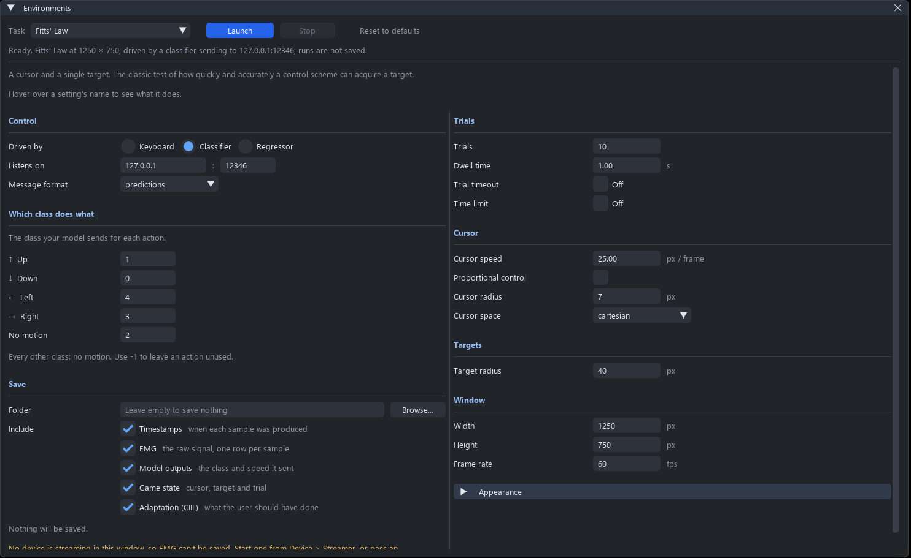
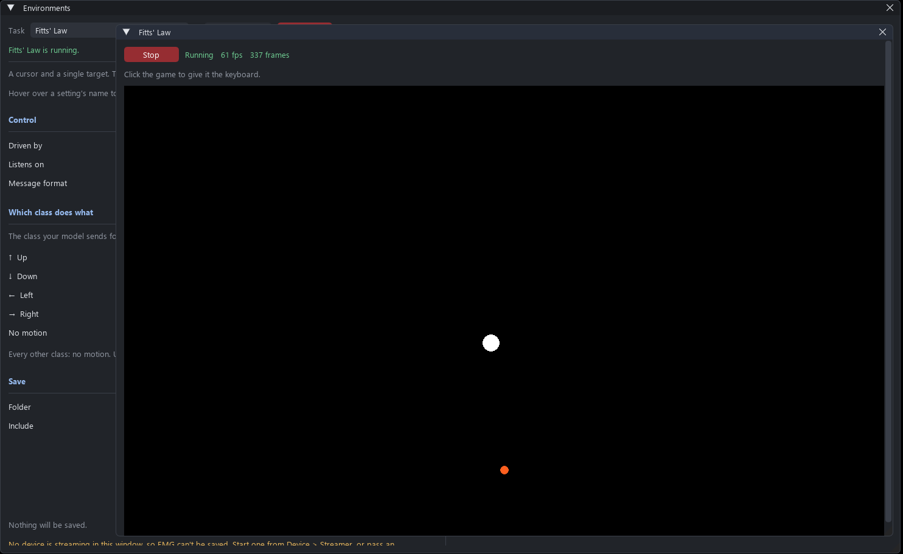

This example goes from an armband on the forearm to a cursor in a Fitts' law task steered by a classifier, without writing a script. It collects five gestures, trains a classifier on them in the pipeline editor, runs that classifier live, and launches the task from **Environments**, all in the LibEMG window.

The steps use a Myo armband at 200 Hz. Any device in **Device > Streamer** works the same way, with its own sampling rate in place of 200. With no hardware, the **Synthetic (no hardware)** device and the **Synthetic Source** block let the whole sequence be rehearsed; the synthetic signal only has a quiet and an active state, so expect a two-class model.

```Python
from libemg.gui import GUI

if __name__ == "__main__":
    gui = GUI(args={'media_folder': 'images/', 'data_folder': 'data/S01/',
                    'num_reps': 3, 'rep_time': 3, 'rest_time': 2, 'auto_advance': True})
    gui.download_gestures([1, 2, 3, 4, 5], 'images/')    # five gestures from the LibEMG gesture library
    gui.start_gui()
```

# 1. Collect the training data

Choose **Device > Streamer**, pick `myo_streamer`, and press **Start**. Wait for the panel to say the device is streaming. **Visualize > Live Signal** is a quick check that every channel is alive.

Then choose **Data > Collect Data**. The configuration window opens on the `args` above: three repetitions of every image in `images/`, three seconds each with two seconds of rest, written to `data/S01/`. Press **Check Signal** to look for dead or noisy channels, then **Start** and follow the prompts. See [screen guided training](../../documentation/screen_guided_training/sgt.rst) for everything this window can do.

The folder then holds one file per prompt, `C_<class>_R_<rep>_emg.csv`, and a `collection_details.json` whose `class_map` says which gesture each class number is. Keep that map at hand: the environment needs it in step 4. With the five gesture images named `Hand_Close`, `Hand_Open`, `No_Motion`, `Wrist_Extension` and `Wrist_Flexion`, the classes are numbered in that order, 0 to 4.

# 2. Train the classifier

Choose **Pipeline > Pipeline Editor** and build an offline pipeline over the folder you just wrote.

| Block | Parameter | Value |
| --- | --- | --- |
| Stored Data | Folder | `data/S01/` |
| | Regex Filters | `C_\|_R\|0,1,2,3,4\|classes`<br>`_R_\|_emg.csv\|0,1,2\|reps` |
| | Sampling Rate | `200` |
| Window | Window Size / Window Increment | `40` / `10` |
| Features | Feature Group | `HTD` |
| Classifier | Model | `LDA` |
| | Fitted Model | `models/S01_lda.pkl` |

Connect Stored Data's **Data** to the Window's **Input**, the Window's **Output** to the Features block, the Features **Output** to the Classifier's **Train Features**, and the Window's **Metadata** to the Classifier's **Train Labels**. Press **Train** on the Classifier. It holds back a fifth of the repetitions to report a validation accuracy and shows both on the block. Press **Save** to write `models/S01_lda.pkl`, and **Save as...** on the toolbar to keep the pipeline as `train.json`.

A pipeline that holds out a repetition for testing, or looks at the features before training, is the same pipeline with more blocks: see [Building and training a pipeline in the GUI](../gui_pipeline_example/gui_pipeline_example.rst).

# 3. Run the classifier live

A live pipeline opens its device itself, from its source block. A Bluetooth armband can only be held by one program, so first press **Stop** in the Streamer panel.

Press **New** in the editor and build the live chain:

| Block | Parameter | Value |
| --- | --- | --- |
| `myo_streamer` (under Sources) | | defaults |
| Window | Window Size / Window Increment | `40` / `10`, as in training |
| Features | Feature Group | `HTD`, as in training |
| Classifier | Fitted Model | `models/S01_lda.pkl` |
| Socket Output | Ip / Port / Protocol | `127.0.0.1` / `12346` / `UDP` |

Connect the device's **EMG** to the Window, the Window's **Output** to the Features block, the Features **Output** to the Classifier's **Features**, and the Classifier's **Output** to the Socket Output. The window and features must match the ones the model was trained with, or the model will be handed feature vectors of the wrong length.

Tick **Watch** on the Classifier's output to see its class probabilities in a Scope window, then press **Start**. The status line counts the rows each stage commits. Every prediction is now sent to `127.0.0.1:12346` as a single number, the class, which is the `predictions` format the environments read.

Save this document too, as `live.json`. Next time, **Open...** it and press **Start**.

# 4. Launch the task

Choose **Environments > Launch Environment** and pick **Fitts' Law**.


<center> <p> The setup screen with the Classifier controller chosen and proportional control off.</p> </center>

| Setting | Value | Why |
| --- | --- | --- |
| Driven by | Classifier | |
| Listens on | `127.0.0.1` : `12346` | Where the Socket Output sends. |
| Message format | `predictions` | What the Socket Output sends: the class alone. |
| Which class does what | from `collection_details.json` | The class your model gives for each direction. The defaults, Up 1, Down 0, Left 4, Right 3 and No motion 2, already suit the five gestures above: hand open moves up, hand close down, wrist flexion left and wrist extension right. |
| Proportional control | off | The class alone carries no speed. Left on, the task stops on the first message asking for velocity control. |
| Trials | `10` | |

Every class without an action of its own holds the cursor still, so a model with more classes than the task has directions can still drive it. Press **Launch**. The task opens in a panel of its own and the cursor follows the classifier.


<center> <p> Fitts' law running inside the LibEMG window, steered by the live pipeline.</p> </center>

**Stop** ends the run. The task can be launched again, or another one chosen, without stopping the pipeline. EMG Hero is driven the same way, with a lane in place of each direction.

# Saving the run

Type a folder under **Save** before pressing Launch, and every run is written to a folder of its own inside it, with the cursor, the target, the classifier's output and the context-informed label of what the user should have been doing at every frame. [Environments](../../documentation/environments/environments.rst) describes the files and how `load_recording` reads them back for retraining.

The EMG of a run comes from the device the window itself is streaming, from **Device > Streamer**. In this example the live pipeline holds the device instead, so a run is saved one row per frame, without EMG. To save EMG as well, drive the task from a model running outside the window, for example an `OnlineEMGClassifier` in a script sending to the same port, while the Streamer panel holds the device.

# Without the GUI

Each step has a script equivalent. The two pipelines are the saved documents:

```Python
from libemg.pipeline import PipelineDocument, compile_pipeline

compile_pipeline(PipelineDocument.load('train.json')).train()   # writes models/S01_lda.pkl
live = compile_pipeline(PipelineDocument.load('live.json'))
live.start()                                                     # predictions go to 127.0.0.1:12346
```

and the task is the environment the setup screen builds, with the controller it builds:

```Python
from libemg.environments._base import PredictionMap
from libemg.environments.controllers import ClassifierController
from libemg.environments.fitts import Fitts, FittsConfig

if __name__ == "__main__":
    controller = ClassifierController(output_format='predictions', num_classes=5,
                                      ip='127.0.0.1', port=12346)
    mapping = PredictionMap.from_actions({'N': 1, 'S': 0, 'W': 4, 'E': 3, 'NM': 2}, default='NM')
    Fitts(controller, FittsConfig(num_trials=10, proportional_control=False),
          prediction_map=mapping).run()
```
