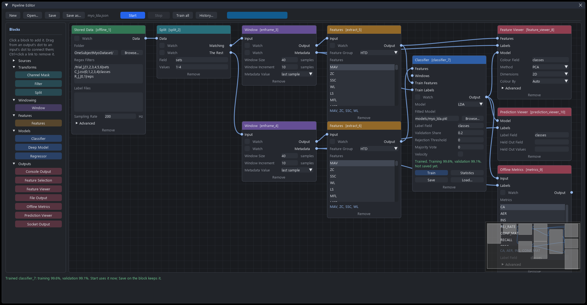
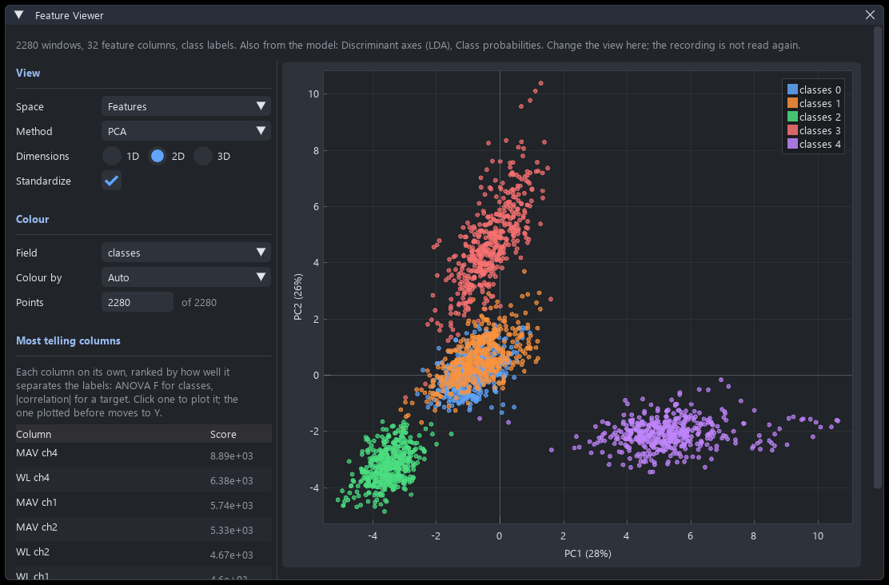
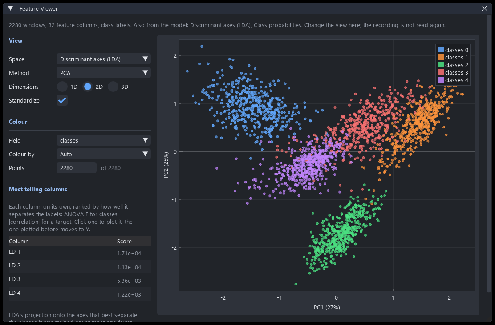
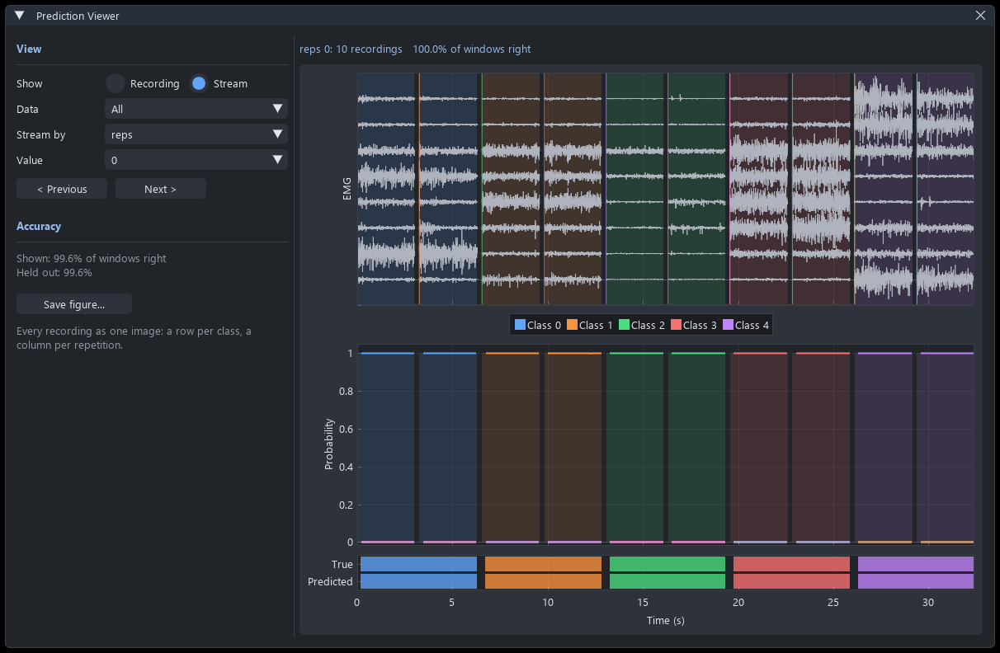

This example builds the [simple offline analysis](../simple_offline_example/simple_offline_example.rst) on the pipeline editor's canvas instead of in a script. It reads a recorded dataset, holds two of its sets out for testing, windows the signal and extracts features, looks at those features through a projection, trains a classifier, and scores it on the held-out sets. At the end, the same pipeline is run from Python with no window open.

Every block, port and parameter used here is described in the [pipeline editor guide](../../documentation/pipeline/pipeline.rst). This page is the walk-through.

# The data

The example uses the `OneSubjectMyoDataset`: one subject, a Myo armband at 200 Hz, five classes, two repetitions of each in six sets. Download it once into the folder the GUI will be opened from:

```Python
from libemg.datasets import OneSubjectMyoDataset

OneSubjectMyoDataset().prepare_data()    # clones it into OneSubjectMyoDataset/
```

Its files are named for what they hold, `OneSubjectMyoDataset/trial_<set>/R_<rep>_C_<class>.csv`, so the set, repetition and class of every recording can be read from its path.

# The pipeline

Open the GUI with `GUI().start_gui()`, then choose **Pipeline > Pipeline Editor**. No device is needed: a pipeline whose source is **Stored Data** reads files, and the editor works out that it is an offline pipeline from that.


<center> <p> The finished pipeline, after the classifier has been trained.</p> </center>

Click each block in the palette on the left to place it, and set its parameters on the block.

| Block | Parameter | Value | Why |
| --- | --- | --- | --- |
| Stored Data | Folder | `OneSubjectMyoDataset/` | |
| | Regex Filters | `/trial_\|/\|1,2,3,4,5,6\|sets`<br>`C_\|.csv\|0,1,2,3,4\|classes`<br>`R_\|_\|0,1\|reps` | One line per field, as `left\|right\|values\|name`. Each turns the text between `left` and `right` in a path into a metadata field. |
| | Sampling Rate | `200` | |
| Split | Field / Values | `sets` / `1-4` | Sets 1 to 4 go to **Matching** for training. Sets 5 and 6 go to **The Rest** for testing. |
| Window (two) | Window Size / Window Increment | `40` / `10` | 200 ms windows every 50 ms at 200 Hz. |
| Features (two) | Feature Group | `HTD` | Hudgins' time domain set: MAV, ZC, SSC and WL on every channel, 32 columns. |
| Classifier | Model | `LDA` | |
| | Fitted Model | `models/myo_lda.pkl` | Where **Save** writes the model, and where a live pipeline loads it from. |
| | Validation Share | `0.2` | A fifth of the training recordings, a fifth of each class, are held back to report a validation accuracy. |
| Feature Viewer | Method / Dimensions | `PCA` / `2D` | Where its window starts. Both can be changed in the window. |
| Offline Metrics | Metrics | `CA`, `AER`, `INS`, `CONF_MAT` | |
| | Null Label | `2` | Class 2 is rest, which active error and instability leave out. |
| Prediction Viewer | | defaults | |

Then connect them by dragging from an output's dot to an input's dot. A link between two ports of different types is refused as it is dragged, so a features output will not attach to a windows input.

| From | To | What it carries |
| --- | --- | --- |
| Stored Data **Data** | Split **Data** | Every recording, with its fields. |
| Split **Matching** | the first Window's **Input** | The training sets. |
| Split **The Rest** | the second Window's **Input** | The test sets. |
| each Window's **Output** | the Features block beside it | Windows. |
| training Features **Output** | Classifier **Train Features** | What the classifier learns from. |
| training Window **Metadata** | Classifier **Train Labels** | The label of each training window. |
| test Features **Output** | Classifier **Features** | What the classifier is run on. |
| training Features **Output** and training Window **Metadata** | Feature Viewer **Features** and **Labels** | The training features, coloured by class. |
| Classifier **Output** | Feature Viewer **Model** | The classifier's own spaces, beside the features. |
| Classifier **Output** and test Window **Metadata** | Offline Metrics **Input** and **Labels** | The test predictions, and what they should have been. |
| Classifier **Output** and test Window **Metadata** | Prediction Viewer **Model** and **Labels** | The same, drawn over the signal. |

Every label comes from a Window block's **Metadata** output, so the windows and their labels always come out of the same block and cannot be misaligned. The **Label Field** on the Classifier, Offline Metrics and viewers picks which field is the label, `classes` by default.

Press **Save as...** on the toolbar and keep the pipeline as `myo_lda.json`. It is a plain JSON file holding the blocks, their settings, the links and the layout.

# Training

Press **Train** on the Classifier block (or **Train all** on the toolbar). It reads the training branch, holds back the validation recordings, fits LDA on the rest and scores both. The block then reports:

```
Trained. Training 99.6%, validation 99.1%.
Not saved yet.
```

**Statistics** on the block shows the detail: how many recordings and windows each side had, accuracy per class, and a confusion matrix of the validation recordings. The validation split is made by whole recordings, never by windows, since neighbouring windows overlap and a window-level split would score the model on data it has effectively seen.

The model is held in memory, so it can be run straight away. Press **Save** on the block to write it to `models/myo_lda.pkl`. That file is an ordinary pickled `EMGClassifier`, with its training statistics and the list of files it was trained on inside it.

# Looking at the features

Press **Start**. The editor reads the recordings once, runs everything downstream of them, and opens a window for each viewer and one for the metrics.


<center> <p> The Feature Viewer: the training windows projected onto their first two principal components.</p> </center>

The **Feature Viewer** shows one point per training window, coloured by class. **Method** sets the projection: the feature columns as they are, PCA, ICA or Isomap, in one, two or three dimensions. **Standardize** scales each column to unit variance first, without which the projection mostly measures which feature has the largest numbers. **Most telling columns** ranks every column on its own by how well it separates the classes, and clicking one plots it.

Because a trained classifier is connected to its **Model** input, **Space** offers the spaces the model works in as well as the features. For LDA these are its discriminant axes and its class probabilities. The features show what a model *could* separate; the model's own spaces show what it did.


<center> <p> The same windows in LDA's discriminant space.</p> </center>

Changing any of these redraws the window without reading the recordings again.

# Scoring it

The **Results** window holds the offline metrics on the two held-out sets, with a heat map of the confusion matrix. **Copy as CSV** puts the table on the clipboard.

| Metric | Value |
| --- | --- |
| CA | 0.9965 |
| AER | 0.0044 |
| INS | 0.0018 |

Four windows of class 3 were called class 1. Every other test window was classified correctly.

A single accuracy says how often a model is wrong, not when. The **Prediction Viewer** shows that, recording by recording or, with **Show** set to **Stream**, as every recording sharing a field value end to end. It draws the EMG tinted by the class performed, the probability of every class over time, and the class predicted under the class performed.


<center> <p> The Prediction Viewer streaming every first repetition of the test sets.</p> </center>

The classifier remembers which recordings it was trained on, so the viewer marks the rest as held out and reports their accuracy separately. **Save figure...** writes every recording to one PNG.

# Running the same pipeline without the window

The file the editor saved is the pipeline. It can be trained and run from Python:

```Python
from libemg.pipeline import PipelineDocument, compile_pipeline

pipeline = compile_pipeline(PipelineDocument.load('myo_lda.json'))
trained = pipeline.train()          # fits the Classifier and saves models/myo_lda.pkl
print(trained['statistics']['validation']['accuracy'])
results = pipeline.run()            # reads the recordings and scores the test sets
print(results['CA'])                # 0.9964912280701754
```

or from a terminal:

```
python -m libemg.pipeline train myo_lda.json
python -m libemg.pipeline check myo_lda.json
```

The viewers only open in the editor. From a script, `pipeline.feature_view` and `pipeline.prediction_view` hold what they would have drawn.

The pipeline can also be written in Python from the start. This builds exactly the document above:

```Python
from libemg.pipeline import PipelineDocument

doc = PipelineDocument()
stored = doc.add_node('source.offline', params={
    'folder': 'OneSubjectMyoDataset/',
    'regex_filters': '/trial_|/|1,2,3,4,5,6|sets\n'
                     'C_|.csv|0,1,2,3,4|classes\n'
                     'R_|_|0,1|reps',
    'sampling_rate': 200})
split = doc.add_node('transform.split', params={'field': 'sets', 'values': '1-4'})
train_window = doc.add_node('window.enframe', params={'window_size': 40, 'window_increment': 10})
test_window = doc.add_node('window.enframe', params={'window_size': 40, 'window_increment': 10})
train_features = doc.add_node('features.extract', params={'feature_group': 'HTD'})
test_features = doc.add_node('features.extract', params={'feature_group': 'HTD'})
classifier = doc.add_node('model.classifier', params={
    'model': 'LDA', 'validation': 0.2, 'model_path': 'models/myo_lda.pkl'})
viewer = doc.add_node('sink.feature_viewer', params={'method': 'PCA', 'dimensions': '2D'})
metrics = doc.add_node('sink.metrics', params={
    'metrics': ['CA', 'AER', 'INS', 'CONF_MAT'], 'null_label': 2})
predictions = doc.add_node('sink.prediction_viewer')

doc.connect(stored, 'emg', split, 'input')
doc.connect(split, 'matching', train_window, 'input')
doc.connect(split, 'rest', test_window, 'input')
doc.connect(train_window, 'output', train_features, 'input')
doc.connect(test_window, 'output', test_features, 'input')
doc.connect(train_features, 'output', classifier, 'train_input')
doc.connect(train_window, 'metadata', classifier, 'train_labels')
doc.connect(test_features, 'output', classifier, 'input')
doc.connect(train_features, 'output', viewer, 'features')
doc.connect(train_window, 'metadata', viewer, 'labels')
doc.connect(classifier, 'output', viewer, 'model')
doc.connect(classifier, 'output', metrics, 'input')
doc.connect(test_window, 'metadata', metrics, 'labels')
doc.connect(classifier, 'output', predictions, 'model')
doc.connect(test_window, 'metadata', predictions, 'labels')

print(doc.validate())               # [] -- nothing stops it running
doc.save('myo_lda.json')            # opens in the editor with Open...
```

# Where to go from here

| To | Change |
| --- | --- |
| Filter the signal first | Put a **Filter** block between Stored Data and Split. It conditions every recording once, for both branches. |
| Compare classifiers | Change the Classifier's **Model** and press **Train** again. Changing a setting drops the old model, so a stale one is never run. |
| Train a neural network | Use a **Deep Model** block instead, fed from the Windows directly or from the features. Its loss is drawn live while it trains. |
| Fit a regressor | Use a **Regressor** with a label field holding a continuous target, read from **Label Files** on Stored Data. The [pipeline editor guide](../../documentation/pipeline/pipeline.rst) reproduces the offline regression example this way. |
| Choose the features | Add a **Feature Selection** block on a Window's Output and Metadata. See [feature selection](../../documentation/feature_selection/feature_selection.rst). |
| Use the model live | Build the same chain on a device source, point the Classifier at `models/myo_lda.pkl`, and add a **Socket Output**. See [Driving an environment with a classifier](../gui_environment_example/gui_environment_example.rst). |
